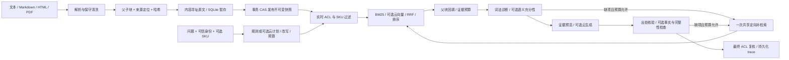

# Adaptive RAG Concept

可运行、可插拔的 RAG 基座，覆盖知识生命周期、检索、证据与评测。默认 `model_free`，不发起模型请求；查询返回 `evidence_preview`、`answer: null`。显式开启后可使用云端 Embedding、Reranker 和带引用的答案生成，也可分别启用会话改写、问题分解、查询扩展与语义质量检查；PDF 可选择本地或 MinerU 云解析。Laya 决策模型继续只保留接口，当前决策策略为规则，本阶段不下载或部署模型。

## 快速开始

需要 Python 3.11+ 与 uv。在仓库根目录运行：

```powershell
uv sync --locked
uv run python -m unittest discover -s tests -v
uv run adaptive-rag capabilities
```

以下 PowerShell 示例可以直接执行，无需手工复制 ID。演示条款均为虚构数据：

```powershell
$job = uv run adaptive-rag ingest --tenant demo --document store-policy --version v1 --file examples/store-policy.md | ConvertFrom-Json
$snapshot = uv run adaptive-rag publish --tenant demo --job $job.job_id | ConvertFrom-Json
$job = uv run adaptive-rag ingest --tenant demo --document a100-warranty --version v1 --file examples/sku-warranty.md --sku A100 | ConvertFrom-Json
$snapshot = uv run adaptive-rag publish --tenant demo --job $job.job_id --expected-generation $snapshot.generation | ConvertFrom-Json
$result = uv run adaptive-rag query --tenant demo --question 'A100 保修规则是什么？' --sku A100 | ConvertFrom-Json
$result | ConvertTo-Json -Depth 12
uv run adaptive-rag trace --tenant demo --id $result.trace_id
uv run adaptive-rag evidence --tenant demo --generation $result.generation --id $result.evidence[0].evidence_id
uv run adaptive-rag eval --tenant demo --fixture examples/eval.jsonl --output .rag-data/eval-result.json
```

CLI 是可信的本地管理入口，`--tenant` 不是远程认证。默认运行数据在 `.rag-data/`，可用全局 `--data-dir` 或 `--config` 更换。重复导入会复用相同 job；内容、元数据或处理配置变化会产生新 revision。导入只暂存，必须显式发布。除首次发布外，写入发布清单必须携带当前 `expected_generation`；并发冲突返回错误，由调用方读取最新状态后决定如何重试。

## 显式启用云模型

普通 CLI 不会自动读取根目录 `.env`。按 [.env.example](.env.example) 在本机填写配置，使用 `--env-file .env` 显式加载，并设置 `RAG_ENABLE_CLOUD=true`，才通过这一入口启用三个云插件。以下示例不含凭证，`RAG_CLOUD_API_KEY` 仅在本机填写：

```dotenv
RAG_ENABLE_CLOUD=true
RAG_CLOUD_BASE_URL=https://dashscope.aliyuncs.com/compatible-mode/v1
RAG_CLOUD_API_KEY=
RAG_LLM_MODEL=deepseek-v4.1-flash-1017
RAG_EMBEDDING_MODEL=qwen3.7-text-embedding-flash
RAG_RERANK_MODEL=qwen3.7-text-rerank
```

```powershell
uv run adaptive-rag --env-file .env capabilities
$result = uv run adaptive-rag --env-file .env query --tenant demo --question 'A100 保修规则是什么？' --sku A100 | ConvertFrom-Json
$result | ConvertTo-Json -Depth 12
uv run adaptive-rag --env-file .env trace --tenant demo --id $result.trace_id
```

这会将 `dense`、`reranker`、`generator` 选为 `cloud`；仅开启 `RAG_ENABLE_CLOUD` 时，计划仍用规则、质量检查仍限出处完整性。没有证据时不会调用生成模型。云端适配按显式平台地址发送凭证，百炼重排使用独立原生接口，协议依据见 [百炼接口核对](docs/research/bailian-api-notes.md)。

以下增强开关默认全部为 `false`，均要求同时设置 `RAG_ENABLE_CLOUD=true`；格式只接受 `true` / `false`，开启后会增加相应的云生成模型请求：

| 开关 | 启用内容 | 边界 |
| --- | --- | --- |
| `RAG_ENABLE_QUERY_PREPARATION` | 云 Planner 语义分解与 rewrite 会话改写 | 最多 3 个子问题；历史用于理解，不能推断或改变可信 SKU、租户及权限 |
| `RAG_ENABLE_QUALITY_CHECKS` | 证据充分性、事实支持性、答案完整性及缺口查询 | 复用同一生成模型独立审查；模型判断可出错，不是已校准的事实证明 |
| `RAG_ENABLE_MULTI_QUERY` | 按原子问题增加同义查询 | 独立可选，不要求开启查询预处理；保留原问并受检索通道预算约束 |
| `RAG_ENABLE_HYDE` | 增加短假设文档用于检索 | 假设文本不会进入证据包或作为回答事实 |

例如，先在选定环境文件中开启查询预处理与质量检查，保留多查询、HyDE 关闭，再用同一 CLI 命令对照评测。查询历史可通过 HTTP `history` 数组或应用层 `QueryRequest.history` 传入；无相关云开关时只校验、计数，不做会话指代消解。trace 的 `history_used` 仅在带历史的相应组件实际发起模型调用时置为 `true`；规则守卫和预算跳过不会误报已使用。商品不明确时仍要求澄清，不能仅凭历史猜 SKU。

启用质量检查后，证据不足返回 `insufficient`，不会将相关片段强行生成为答案；仅部分子问题有充分证据时可返回 `partial`。生成后检查每条 claim 是否被其引用支持，以及是否遗漏问题要点；未支持或矛盾的 claim 不会出现在最终答案。生成前与生成后的定向补检索**合计最多一次**，共享 12 个检索通道的总预算；初检保留原问并为补救预留通道。生成后只有加入新证据才重新生成并复验，重复结果或预算耗尽时返回已支持部分或 `insufficient`。非法审查 JSON、未知引用及模型调用失败会安全报错，不会把未核验草稿当作通过结果。

容器可由部署系统显式注入相同环境变量，进程环境优先于指定的本地文件。`.env` 和带凭证的配置不进入 Git、镜像或公开日志；模型 Key 与本项目 HTTP 的 Bearer token 分开生成和保存。

## PDF 解析与对比

本地解析无需 Key；MinerU 需要本机 `.env` 中的 `MINERU_API_KEY`，并会把所选 PDF 上传到 MinerU。可对同一 PDF 分别输出 Markdown，再比较页序、标题、表格、公式及文本完整性：

```powershell
$pdf = Get-ChildItem -File -Filter *.pdf | Select-Object -First 1
if (-not $pdf) { throw '请先在当前目录放置 PDF' }
uv run adaptive-rag parse-pdf --file $pdf.FullName --backend local --output .rag-data/pdf-local.md
uv run adaptive-rag --env-file .env parse-pdf --file $pdf.FullName --backend mineru --output .rag-data/pdf-mineru.md --checkpoint .rag-data/mineru-checkpoint.json
```

`--checkpoint` 仅供 MinerU 使用，保留同一 PDF 与解析配置的批次状态；失败后用同一路径重试可恢复已确认的批次，提交结果不明时会停下而不会自动重复提交。`parse-pdf` 只写解析产物，不会发布知识。选择产物后可用普通 Markdown `ingest`，或直接 `ingest --file <PDF路径> --pdf-backend local|mineru --pdf-checkpoint <检查点路径>` 暂存并归档原 PDF，随后按已有 CAS 流程发布；本地后端不传检查点。解析代码默认 `local`，本轮实际 `.env` 已根据样本选择 `RAG_PDF_BACKEND=mineru`，可用 CLI 参数覆盖。

此前三模型请求、整篇论文问答、PDF 公式/表格对照和当时限制见[实践验收报告](docs/research/cloud-and-parser-validation.md)；其中记录的结果不代表新增增强开关已经通过业务质量评测。对该样本优先 MinerU；图像资源和原 PDF 页坐标尚未进入证据服务。分块现已识别 Markdown 表格、HTML 表格、围栏代码和常见闭合块公式：在相应父/子块字符上限内尽量整体保留；已识别的超长结构按预算分片，在 locator 标记 `structure_fragment`。未闭合代码和 HTML 表格也可标记，未闭合公式尚未专门识别；不补造表头或公式定界符。该保护以解析后的 Markdown 为输入，不等于完整文档结构理解。

## 已实现链路

证据保留原始 `heading_path`，并随引用回源返回；生成、证据判断和答案核验以独立元数据接收标题路径，正文、哈希和证据 ID 保持原文语义。云请求的标题上下文共用 8,000 字符预算，超出时明确标记截断。标题用于解释来源范围，和正文一样属于不可信数据，不授予权限。



| 环节 | 当前实现 | 替换边界 |
| --- | --- | --- |
| 入库 | plain、ATX Markdown、惰性 HTML；PDF 本地/MinerU 转 Markdown；结构保护父子切块与配置指纹 | `Parser` / `Cleaner` / `Chunker` |
| 知识生命周期 | 暂存、显式发布、不可变快照、CAS、删除、回滚 | `KnowledgeStore` |
| 原文与 trace | 内容寻址文件、SQLite | `ObjectStore` / `TraceSink` |
| 计划与控制 | 默认规则、可选云语义分解；最多 3 子问题、12 总通道、一次共享补救；Laya 未接入 | `Planner` / `DecisionPolicy` |
| 查询变换 | 已有云改写、多查询、HyDE、定向 gap 实现，按独立开关显式开启 | `QueryTransform` |
| 检索 | 默认 BM25 + RRF；显式启用云 Embedding 与本地精确余弦 dense | `Retriever` / `Fusion` |
| 排序 | 默认保序截断；可选云 Reranker | `Reranker` |
| 证据检查 | 默认词法诊断及引用完整性；可选云充分性、事实支持性、完整性及有界补救 | `EvidenceJudge` / `Verifier` / `AnswerVerifier` |
| 生成 | 默认关闭，返回 `answer=null`；可选云端带引用 claims | `Generator` |
| 入口与评测 | CLI、鉴权 HTTP、JSONL 检索指标 | `RagApplication` |

接口在 [ports.py](adaptive_rag/ports.py)，数据契约在 [domain.py](adaptive_rag/domain.py)，插件装配在 [plugins.py](adaptive_rag/plugins.py)，状态与权限约定见 [实施契约](docs/foundation-contract.md)。没有通过字符串自动 import 的入口。插件由可信 Python 代码显式注册，并按角色选择；模型或网络插件只有获得对应显式许可后才执行工厂。插件代码本身属于可信代码边界，声明不构成进程沙箱。

```python
from adaptive_rag.app import RagApplication
from adaptive_rag.config import Settings
from adaptive_rag.plugins import default_registry

registry = default_registry()
# LocalRetriever implements async search(query, authorized_chunks, limit).
registry.register('lexical', 'my_local_search', lambda settings: LocalRetriever())
app = RagApplication(Settings(plugins={'lexical': 'my_local_search'}), registry)
```

## HTTP 本机入口

直接启动 HTTP 服务即可使用账号登录，无需先配置 HTTP Key：

```powershell
uv run adaptive-rag serve
```

服务默认仅绑定 `127.0.0.1:8000`。在浏览器打开根路径，以固定管理员 `ragadmin` / `ragadmin123` 登录。管理员可在「账号管理」中创建、查看和删除普通账号；固定管理员不能删除。普通账号登录后可检索知识库、查看执行链路和引用证据，文档维护、作业读取和账号管理仍要求管理员。

账号与会话存放在数据目录的 `accounts.sqlite3`，服务重启后保留。浏览器通过 `an_rag_session` Cookie 保持登录，刷新页面自动恢复未过期会话；退出登录或删除账号后，原会话失效。页面不保存密码或模型 Key。普通账号共享管理员所在知识库租户，但仍使用独立身份检查现有文档权限。

浏览器知识库租户优先由 `Settings.browser_tenant` 指定；使用环境配置时，`RAG_HTTP_TENANT` 设置该值。未显式指定时，沿用唯一管理员 token 所在租户；没有唯一值则使用 `demo`。已有账号数据库的租户与新配置不一致时拒绝启动，不会自动迁移账号或知识库。

现有 Bearer 客户端继续兼容，供 CLI 脚本或维护程序使用。可按 [公开配置示例](examples/settings.example.toml) 添加 token 与可信身份映射，或通过 `--env-file .env serve` 读取 `RAG_HTTP_API_TOKEN`、`RAG_HTTP_TENANT`、`RAG_HTTP_SUBJECT`；浏览器使用不依赖这些配置。HTTP token 至少 24 个非空白字符，独立于 `RAG_CLOUD_API_KEY` 与 `MINERU_API_KEY`。请求正文仍禁止指定 `tenant_id`、`subject_id`、`groups`。

| 方法 | 路径 | 用途 |
| --- | --- | --- |
| GET | `/`、`/static/*` | 同源检索工作台与静态资源 |
| POST | `/auth/login`、`/auth/logout` | 账号登录与退出 |
| GET | `/console/session` | 当前登录身份与插件配置 |
| GET / POST / DELETE | `/admin/users`、`/admin/users/{username}` | 管理员列出、创建、删除普通账号 |
| GET | `/health`、`/capabilities` | 健康与插件状态 |
| POST | `/documents`、`/publish` | 暂存与 CAS 发布 |
| POST | `/query` | 规则编排、证据预览及显式启用的云查询/生成/质量检查 |
| POST | `/query/stream` | 登录用户的实时阶段事件，完成后返回结果与授权 Trace |
| GET | `/jobs/{id}` | 管理员作业读取 |
| GET | `/traces/{id}` | 同租户链路诊断，按当前源权限复核 |
| GET | `/evidence/{generation}/{evidence_id}` | 按快照回源并复核实时 ACL |
| POST | `/access`、`/documents/delete`、`/rollback` | 撤权、删除、回滚 |

### 检索工作台

启动同一个 HTTP 服务后，在浏览器打开 `http://127.0.0.1:8000/`，用分配的账号和密码登录，再输入问题运行。服务器部署时使用该实例的 HTTPS 根地址。工作台只向当前页面的同源服务请求数据，不需要填写 HTTP Key、云模型 Key 或 MinerU Key。

界面参考 MinerU 解析台的白灰底色、蓝色操作按钮和细分隔线：左侧查看会话、检索设置与实际执行流程，中间进行对话并输入问题，右侧查看步骤详情、证据、模型调用及 JSON。正文和输入框保持 15–16px，完整 Trace ID 可复制并加载回放。

页面显示真实执行时间线、各步状态与服务端耗时，并可查看结构化返回、最终回答、逐条引用、证据回源、模型调用及平台返回的 Token 用量。实时事件先展示阶段元数据，结果经最终权限检查与 Trace 持久化后再展示内容；未启用或因预算跳过的步骤会明确标记。按 Trace ID 可重新加载历史记录并复核当前权限，也可下载本次运行 JSON。会话列表仅保留在当前页面；下载文件包含问题与证据，应按知识库数据管理。

当前页面用于已有知识库的检索与诊断，文档导入、发布、撤权和回滚仍使用现有 CLI 或 HTTP 接口。详细操作与事件契约见 [检索工作台说明](docs/workbench.md)。

## 不变量与当前边界

- 快照保存内容版本；权限始终实时检查。删除立即撤销历史文档读取；回滚不会自动恢复权限。重复导入或发布也不会重置 ACL。管理员可以通过 `access` 显式重新授权。
- 每次查询固定一个 generation；检索插件只能返回来自该次已授权候选的原始块，融合及排序只能处理输入候选，不能改写内容、越权添块或改变子问题 ID。证据回源不信任客户端的 parent/revision 清单。
- `no_index`、`empty`、`clarify`、`capability_unavailable`、`partial`、`insufficient`、插件错误、超时各自可辨。`partial` 只包含通过当前检查的事实，`missing_query_ids` 标识仍需确认的子问题；`insufficient` 不返回无法支持的答案。trace 保存插件、阶段状态、耗时、实际 child IDs、覆盖、核验与补救诊断；默认模型调用为零，云查询按实际请求尝试（含重试）记录调用次数、网络次数、模型耗时及平台返回的 token 用量。全局 capabilities 不预估云调用次数，以每次查询的 usage/trace 为准；配置密钥不写入 trace。trace 含问题与证据，属于敏感本地数据。
- 基座使用字符预算，不将字符数声称为模型 token 数。截断证据带 `truncated=true`，正文摘录 hash 与完整父块 source hash 分开。
- 词法覆盖不等于语义充分性；默认引用核验只检查出处/哈希/ID，`support_checked=false`。开启质量检查才进行云语义判断并记录 `support_checked` / `completeness_checked`；审查器与生成器共用模型，仍需独立业务 gold 验证质量。云查询预处理可结合 history 理解问题，不授予权限、不代替商品身份确认。
- 默认 BM25 每次对授权块计算词法统计；云 dense 对授权块精确计算余弦，相同模型配置的向量缓存在 SQLite，冷查询才补算缺失文档向量。两者适用于当前小规模验证，尚无生产 ANN/倒排索引、离线双索引就绪发布、独立向量库、分布式任务、迁移管理或高可用方案。已有手动冷备和隔离恢复检查脚本，尚无自动调度、异机副本及生产原位自动恢复。
- HTML 不执行脚本或网络请求；Markdown 暂支持 ATX 标题。结构保护不取消字符上限，超长表格、代码、公式和单行会分片并标记；不能把分片当成完整表格/公式。归档保留传入文本的 UTF-8 字节，引用文本不补造结构。
- 超时约束协作式 async 插件与调用等待，不能强制终止不协作的 Python 插件。同步阶段在线程中执行，超时后线程仍可能完成；CLI 退出还需等待线程收尾。trace 保存有预留预算，保存失败会使成功查询报错。这里不是进程级硬实时保证。

## 评测与下一阶段准入

`eval` 固定快照，只对非空 gold 题计算 Hit@K、Recall@K、MRR@K、NDCG@K；无 gold 的题单列空检索率，不能当作拒答准确率。支持 `gold_document_ids` 或 `gold_chunk_ids`，不混用。示例集很小，只验证流程，不代表真实业务质量。

已接入的三个模型均走云平台 API Key，默认仍关闭；查询增强和质量审查复用生成模型，不增加本地模型部署。HTTP 429/5xx 最多重试一次，鉴权错误、重定向和超时不自动重试；向量缓存按模型及维度配置隔离。检索指标不验证生成答案、审查器判定或整体拒答质量。下一步用业务标注集评测答案、解析和检索质量，对增强开关做消融，再决定配额、生产索引及扩容；Laya 决策模型后续单独部署与微调，本阶段不启用。原专题分析见 [RAG 流程与实现实践报告](docs/research/RAG流程与实现实践报告.md)。

## 云服务器与 Docker

单机方案需要应用容器、HTTPS 网关及持久化磁盘。SQLite、文件归档、向量缓存是进程内/本机存储，当前无需先安装 MySQL、Milvus 或 Redis。通用 Compose 使用 Caddy；指定服务器的同机共存方案使用宿主现有 Nginx、独立 `/opt/an-RAG` 目录及 an-rag Compose 命名空间，不额外部署 Caddy。后端只映射回环地址，公网端口、TLS 和其他项目共存必须现场验证。

已有项目专用冷备脚本：获取维护锁、短暂停止本项目写进程、归档数据与私密配置并恢复原运行状态；恢复检查只在独立目录校验归档、SQLite 和内容寻址对象，不覆盖生产数据，也不等于从恢复数据启动应用的演练。备份含秘密，必须限制访问。没有自动调度或异机副本，仓库中的部署文件本身不证明服务已上线。

中间件与扩容边界见 [云服务器部署与中间件方案](docs/deployment.md)；安装、备份与回退命令见 [服务器部署产物说明](deploy/README.md)；实际部署记录与未完成验收见 [服务器部署记录](docs/deployment-server.md)。
