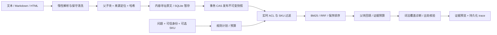

# Adaptive RAG Concept

可运行、可插拔的 RAG 无模型基座。当前先打通知识生命周期、检索、证据与评测；不读取模型密钥、不下载模型、不调用云平台或 Laya。默认查询返回 `evidence_preview`、`answer: null`，不会把摘录当作生成答案。

## 快速开始

需要 Python 3.11+ 与 uv。在仓库根目录运行：

```powershell
uv sync --locked
uv run python -m unittest discover -s tests -v
uv run adaptive-rag capabilities
```

以下 PowerShell 示例可以直接执行，无需手工复制 ID。演示条款均为虚构数据：

```powershell
$job = uv run adaptive-rag ingest --tenant demo --document store-policy --version v1 --file examples/store-policy.md | ConvertFrom-Json
$snapshot = uv run adaptive-rag publish --tenant demo --job $job.job_id | ConvertFrom-Json
$job = uv run adaptive-rag ingest --tenant demo --document a100-warranty --version v1 --file examples/sku-warranty.md --sku A100 | ConvertFrom-Json
$snapshot = uv run adaptive-rag publish --tenant demo --job $job.job_id --expected-generation $snapshot.generation | ConvertFrom-Json
$result = uv run adaptive-rag query --tenant demo --question 'A100 保修规则是什么？' --sku A100 | ConvertFrom-Json
$result | ConvertTo-Json -Depth 12
uv run adaptive-rag trace --tenant demo --id $result.trace_id
uv run adaptive-rag evidence --tenant demo --generation $result.generation --id $result.evidence[0].evidence_id
uv run adaptive-rag eval --tenant demo --fixture examples/eval.jsonl --output .rag-data/eval-result.json
```

CLI 是可信的本地管理入口，`--tenant` 不是远程认证。默认运行数据在 `.rag-data/`，可用全局 `--data-dir` 或 `--config` 更换。重复导入会复用相同 job；内容、元数据或处理配置变化会产生新 revision。导入只暂存，必须显式发布。除首次发布外，写入发布清单必须携带当前 `expected_generation`；并发冲突返回错误，由调用方读取最新状态后决定如何重试。

## 已实现链路



| 环节 | 当前实现 | 替换边界 |
| --- | --- | --- |
| 入库 | plain、ATX Markdown、惰性 HTML；父子切块与配置指纹 | `Parser` / `Cleaner` / `Chunker` |
| 知识生命周期 | 暂存、显式发布、不可变快照、CAS、删除、回滚 | `KnowledgeStore` |
| 原文与 trace | 内容寻址文件、SQLite | `ObjectStore` / `TraceSink` |
| 计划与控制 | 明确规则、最多 3 子问题、12 通道、一次补检 | `Planner` / `DecisionPolicy` |
| 查询变换 | 改写、多查询、HyDE、gap 默认关闭 | `QueryTransform` |
| 检索 | 实际 BM25 + RRF；dense 关闭 | `Retriever` / `Fusion` |
| 排序 | 保序截断，不声称模型重排 | `Reranker` |
| 证据检查 | 词法重叠诊断、来源与引用哈希 | `EvidenceJudge` / `Verifier` |
| 生成 | 默认关闭，返回 `answer=null` | `Generator` |
| 入口与评测 | CLI、鉴权 HTTP、JSONL 检索指标 | `RagApplication` |

接口在 [ports.py](adaptive_rag/ports.py)，数据契约在 [domain.py](adaptive_rag/domain.py)，插件装配在 [plugins.py](adaptive_rag/plugins.py)，状态与权限约定见 [实施契约](docs/foundation-contract.md)。没有通过字符串自动 import 的入口。插件由可信 Python 代码显式注册，并按角色选择；注册为模型或网络的插件在工厂执行前被拒绝。插件代码本身属于可信代码边界，声明不构成进程沙箱。

```python
from adaptive_rag.app import RagApplication
from adaptive_rag.config import Settings
from adaptive_rag.plugins import default_registry

registry = default_registry()
# LocalRetriever implements async search(query, authorized_chunks, limit).
registry.register('lexical', 'my_local_search', lambda settings: LocalRetriever())
app = RagApplication(Settings(plugins={'lexical': 'my_local_search'}), registry)
```

## HTTP 本机入口

按 [公开配置示例](examples/settings.example.toml) 创建 `config.local.toml`，在本机添加 token 与可信身份映射。可用 `uv run python -c "import secrets; print(secrets.token_urlsafe(32))"` 生成随机令牌。该私有配置已被 Git 忽略。配置至少一个身份后启动：

```powershell
uv run adaptive-rag --config config.local.toml serve
```

服务默认仅绑定 `127.0.0.1:8000`。除 `GET /health` 外，业务接口需 `Authorization: Bearer <本机配置中的令牌>`。身份来自 token 映射，请求正文禁止 `tenant_id`、`subject_id`、`groups`。写接口、job 与 trace 读取要求管理员；query 与 evidence 依实时 ACL。

| 方法 | 路径 | 用途 |
| --- | --- | --- |
| GET | `/health`、`/capabilities` | 健康与插件状态 |
| POST | `/documents`、`/publish` | 暂存与 CAS 发布 |
| POST | `/query` | 规则编排和证据预览 |
| GET | `/jobs/{id}`、`/traces/{id}` | 作业与链路诊断 |
| GET | `/evidence/{generation}/{evidence_id}` | 按快照回源并复核实时 ACL |
| POST | `/access`、`/documents/delete`、`/rollback` | 撤权、删除、回滚 |

## 不变量与当前边界

- 快照保存内容版本；权限始终实时检查。删除立即撤销历史文档读取；回滚不会自动恢复权限。重复导入或发布也不会重置 ACL。管理员可以通过 `access` 显式重新授权。
- 每次查询固定一个 generation；检索插件只能返回来自该次已授权候选的原始块，融合及排序只能处理输入候选，不能改写内容、越权添块或改变子问题 ID。证据回源不信任客户端的 parent/revision 清单。
- `no_index`、`empty`、`clarify`、`capability_unavailable`、插件错误、超时各自可辨。trace 保存插件、阶段状态、耗时、实际 child IDs、覆盖诊断与零模型调用指标；不保存配置密钥。trace 含问题与证据，属于敏感本地数据。
- 基座使用字符预算，不将字符数声称为模型 token 数。截断证据带 `truncated=true`，正文摘录 hash 与完整父块 source hash 分开。
- 词法覆盖不等于语义充分性；引用核验只检查出处/哈希/ID，不判断事实蕴含。history 当前仅校验与计数，不做多轮指代消解。
- 默认 BM25 每次对授权块计算词法统计，适用于小规模本地验证。尚无生产规模倒排索引、向量库、分布式任务、迁移管理、备份恢复、限流与高可用网关。
- HTML 不执行脚本或网络请求；Markdown 暂支持 ATX 标题。超长单行和表格行按字符上限硬切。归档保留传入文本的 UTF-8 字节。
- 超时约束协作式 async 插件与调用等待，不能强制终止不协作的 Python 插件。同步阶段在线程中执行，超时后线程仍可能完成；CLI 退出还需等待线程收尾。trace 保存有预留预算，保存失败会使成功查询报错。这里不是进程级硬实时保证。

## 评测与下一阶段准入

`eval` 固定快照，只对非空 gold 题计算 Hit@K、Recall@K、MRR@K、NDCG@K；无 gold 的题单列空检索率，不能当作拒答准确率。支持 `gold_document_ids` 或 `gold_chunk_ids`，不混用。示例集很小，只验证流程，不代表真实业务质量。

后续模型接入设计遵循：除 Laya 外均走云平台 API Key 适配器；Laya 决策模型单独部署与微调，本阶段不启用。模型阶段需另行定义云端错误重试、限额、密钥注入、embedding 索引版本和语义评测，完成验收后再开放相应插件。原专题分析见 [RAG 流程与实现实践报告](docs/research/RAG流程与实现实践报告.md)。
