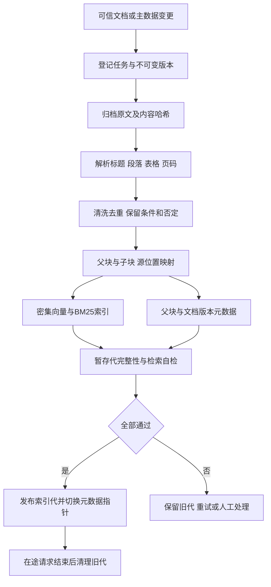
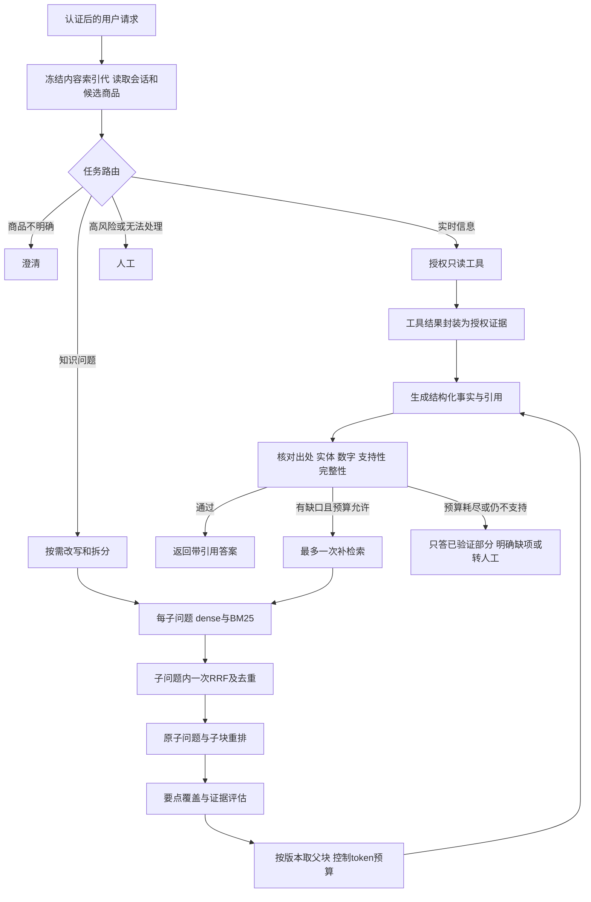

# RAG 流程与实现实践报告

> 分析对象：根目录 [RAG专题.html](../../RAG专题.html)，标题“RAG 专题：全链路交互版”。
> 分析及官方资料访问日期：2026-11-15。
> 交付范围：文件静态分析、关键技术核验、实施设计、评测与资源计划。未执行 HTML 脚本，未安装依赖、下载模型或进行推理压测。本文不是已完成系统的测试报告。

## 1. 结论与实施建议

这份 HTML 对 RAG 的讲解较完整，覆盖了**离线知识入库、在线检索生成、评测回流**三条链路。值得保留的主线是：结构化解析与父子分块 → 稠密和关键词混合检索 → 重排 → 回填可信原文 → 带引用回答 → 校验与有限补检索。它适合作为架构学习材料和需求讨论稿，但其中大量代码是片段，部分片段存在确定的语法、数据契约和控制流问题，不能直接拼接成生产系统。[H：L1070 起；L1953 起；L4010 起；L4612 起]

**可行的实践路线是“可靠基线 → 规则自适应 → 学习型决策器”**，不建议一开始同时建设 Laya 训练、HyDE LoRA、多模型校验、全渠道接入和复杂日志平台。

1. **第一阶段先闭环**：可信文档入库、版本可追踪、dense + BM25、一次融合与重排、引用生成、无证据拒答、人工评测。
2. **第二阶段再按需增强**：会话改写、多意图拆分、有限查询扩展、按缺口补检索；每加一项做消融，证明收益足以覆盖成本。
3. **第三阶段才实验学习型决策器**：有稳定标签、域内校准和真实流量回放后，再比较 Laya 与规则版。微调 reranker、embedding 或 HyDE 都需单独证明收益。

原文件的“约 4.2 秒”“CPU 决策约 30 毫秒”、训练时长和效果提升，均不能视为当前项目的测量结果。有的段落明确标注“示意”，有的使用“实测”但没有提供数据、环境与实验记录；本报告将它们统一视为**待复现的教学数字**，不用来做容量或采购承诺。[H：L1070–1150；L5355–5356；L5511；L5961 起]

两项官方核验会影响技术选择：Laya 当前 `choice.confidence` 是分布集中程度，不能直接解释成正确概率；MinIO 社区仓库截至访问日已经归档且声明不再维护。因此，本方案以规则版起步，并以 **S3 兼容对象存储接口**替代绑定旧 MinIO 社区部署教程的设计。[S06][][S07][][S14][]

## 2. 分析依据与原文定位

### 2.1 文件与证据口径

- 文件大小：642,683 字节。
- SHA-256：`013c8760c705463f075dc046d48ed3a2ec520205cd674106e9343b4833b06770`。
- `H：Lx–Ly` 表示该原始 HTML 的源码行号，不是浏览器显示的段落号。后续修改 HTML 后，行号可能变化，应结合文件哈希定位。
- **文件观察**：原文写了什么，代码实际上做了什么。
- **官方核验**：论文、官方仓库、模型卡和文档能够支持什么。
- **实施建议**：本项目可采用的设计，尚未经过本项目实验验证。

仓库目前没有可用于验证整套 RAG 的运行程序、业务文档集合、人工 gold 和模型压测记录。本次提供的是可进入开发的实践方案，不把静态讲解当成系统已经上线的证据。

### 2.2 原文件的知识地图

| 内容 | 原文起始行 | 对落地的作用 |
|---|---:|---|
| 总览 | 1070 | 区分离线、在线和反馈闭环 |
| 数据来源与数据中台 | 1708 | 明确来源权威性和变更入口 |
| 清洗切分、增强父子分块 | 1953 | 决定可检索性、上下文完整性和引用位置 |
| Milvus / MySQL / MinIO | 2495 | 存储分工、跨库关联与版本切换 |
| 网关、会话和商品识别 | 3057 | 处理“这个、上周买的”等上下文依赖 |
| Laya 路由和开关 | 3534 | 选择知识、实时工具、澄清和人工路径 |
| 查询改写与问题分解 | 3634 | 把一个请求拆成可检索的任务 |
| 多查询与 HyDE | 3681 | 弥补用户口语与文档用语的差距 |
| 混合检索 | 4010 | 同时覆盖语义和精确词匹配 |
| RRF 与精排 | 4163 | 合并候选并重新判断问题—片段匹配 |
| 检索结果评估 | 4525 | 判断证据是否足以回答 |
| 父块回填与引用生成 | 4612 | 控制上下文与答案出处 |
| 回源核对与迭代检索 | 4648 | 发现错误和遗漏，有限修复 |
| 返回体验与追踪日志 | 4760 / 4817 | 延迟、成本、可解释性与排障 |
| 评测、消融、训练、质检回流 | 4957 / 5323 / 5890 | 决定增强是否值得上线 |
| 模型选型与微调 | 5961 | 优先调数据和检索，再考虑训练 |

原文前面的交互总图还嵌入了核心代码，例如网关 L669、补检索 L820、证据构造 L838、迭代循环 L934。审查时需要同时看总图代码与后面正文，二者并非始终一致。

### 2.3 不要混淆的概念

| 名称 | 官方工作或技术的要点 | 本 HTML 与它的关系 |
|---|---|---|
| RAG | 用检索得到的外部知识支撑生成 | 是主干能力；检索器、生成器、数据与评测缺一不可 [S01][] |
| Adaptive-RAG | 按问题复杂度选择不检索、单步或迭代策略，用自动产生的监督训练小分类器 | 原文的 HyDE 开关等属于项目自定义扩展；原文也明确不是原论文直接复现 [S02][]，另见H：L3534–3680 |
| CRAG | 检索评估器驱动纠正，可引入网页检索并做知识精炼 | 原文借用评估和分档思想，改成内部知识补检索，属于业务改造 [S03][] |
| Self-RAG | 训练生成模型使用反思 token 控制检索和批判输出 | 外置事实校验器和完整性分类器只是借鉴，不能称为完整复现 [S04][] |
| HyDE | 生成假设文档，再通过编码器检索真实文档 | 假设内容可能错误，只能作为查询扩展，不能作为回答证据 [S05][] |
| Laya | 结构化决策模型与库，不负责替你完成整个 RAG 系统 | 是后续可替换的决策器候选，不是起步必需依赖 [S06][][S07][] |

本文不把 `arxiv:2501.09136` 当作 Laya 论文：该编号对应 Agentic RAG 综述。[S17][]

## 3. 应当落地的完整流程

### 3.1 离线链路：先使知识可信、可检索、可更新



| 步骤 | 输入 → 输出 | 具体实施与检查 |
|---|---|---|
| 来源登记 | 文件/变更事件 → 入库任务 | 记录来源、租户、业务作用域、生效时间、授权范围；只接入确认可用的来源 |
| 任务幂等 | `tenant + doc + source_version + processing_fingerprint` → job | fingerprint含元数据、解析/切分/模型等配置；数据库唯一约束和可恢复状态；失败可重试，不能把“拿过锁”当成“已成功入库” |
| 原文归档 | 原始 bytes → immutable object key | 保存 SHA-256、媒体类型、大小；地址不能指向会被覆盖的“latest.pdf” |
| 结构化解析 | PDF/HTML/表格 → 结构树 | 保存章节、列表、表头、页码或字符偏移；扫描件走 OCR 并标记低质量区域 |
| 清洗 | 结构树 → 规范化结构树 | 去页眉页脚和重复内容，保留“不支持”“除外”、单位、期限及脚注；表格转文本时带表头和适用条件 |
| 父子分块 | 结构树 → parents / children | 子块用于检索，父块用于语境；二者必须具有相同文档版本和可回源位置 |
| 索引 | children → dense + BM25 | 固定模型 revision、tokenizer、分词器和切分版本；失败不发布半套索引 |
| 发布自检 | 暂存数据 → READY | 校验计数、父子引用、向量维度、空文、权限字段、样例召回及跨版本查询 |
| 发布 | READY → ACTIVE | 先确认外部索引可读，再在 MySQL 事务中切换发布指针；不是跨三库分布式原子提交 |
| 清理 | 旧代 → RETIRED | 超过在途请求和回滚保留期后清理；删除与权限撤销另有即时阻断路径 |

**切分起点建议**：沿用原文“子块约 200–400 中文字、父块约 1,500–2,000 字”的量级做第一轮实验，但不要把字数视为 token 数，也不要强行切断表格行、编号步骤或“前提—结论—例外”。重叠量可从相邻一两句开始比较。最终以业务 gold 的证据覆盖、召回与 token 成本选择，而非只追求平均块长。[H：L1953 起；本项目建议]

存储 `body` 与 `retrieval_text` 两份逻辑表示：前者保留可引用原文，后者可增加“商品名｜章节路径｜表头”等前缀。前缀用于帮助检索，不能把系统补充的标签伪装成原文事实。来源、标题、SKU、权限或有效期改变，即使文件 bytes 不变，也需要更新相关元数据或重建索引；幂等指纹应包含这些因素和处理流水线版本。

### 3.2 在线链路：围绕“问题要点—证据—事实”组织



混合请求可以同时包含知识和实时任务。例如“这款能机洗吗，现在还有货吗”应拆成知识检索与库存查询两个任务，再汇总结果；不能强迫整个请求只选一个全局路由。退款操作或其他写入动作不在本次只读 RAG 首期范围内。

| 阶段 | 输入 → 输出 | 落地要点 |
|---|---|---|
| 身份与权限 | 登录凭证 → QueryContext | 租户和用户身份从认证结果取，不接受模型或请求正文自报 tenant |
| 实体解析 | 原问题、会话快照、订单候选 → resolved / clarify / unknown | 优先显式 SKU/商品卡片，再用上下文；冲突时追问，不把多候选硬压成一个 |
| 路由 | 意图、实体、权限 → 任务计划 | 寒暄直接回复；静态知识走 RAG；价格、库存、订单走实时系统；无法处理转人工 |
| 改写与拆分 | 原问题及历史 → 原子问题和必答要点 | 保留否定、数值、约束及原问题；不能将猜测的商品名写入确定事实 |
| 检索 | 每个原子问题及统一过滤条件 → 多路 hits | 每一路同时带 tenant、ACL、内容代、语言和业务作用域约束 |
| 融合与重排 | 有序 hits → 去重后的候选和 Top-N | 不直接相加 dense 与 BM25 原始分；按子问题保留覆盖，重排用真实子问题而非 HyDE 草稿 |
| 充分性判断 | 要点清单、候选证据 → 已支持 / 缺失 / 冲突 | “有一条很相关”不等于“所有要点都答全”；政策期限、例外与凭证需分别检查 |
| 上下文装配 | 命中子块 → 带源位置的证据包 | 批量回填父块、按版本校验、去重、限 token；压缩后仍保留对应原文 span |
| 生成与校验 | 证据包 → claims + citation IDs | 检查引用存在、事实被支持、没有错 SKU/单位/期限；修复后再校验 |
| 有限恢复 | 缺失要点 → 一次补检索或终态 | 新证据合并后重排、重判覆盖、重建证据包；重复结果或超过 deadline 就终止 |

### 3.3 用原文的保温杯问题走一遍

以下商品与条款是**原文件示例，不代表真实商家承诺**。[H：L669–946；L4990 起]

用户：“我上周买的 500ml 那个保温杯，能放洗碗机吗？要是坏了怎么保修？”

1. 先根据订单候选、商品卡片与会话确认 `SKU-88120`；无法唯一确认则问“您指的是哪一款”，停止后续商品事实生成。
2. 形成两个原子问题：`q1 清洗方式`、`q2 保修政策`。q2 再列出“期限、适用条件/除外、申请方式和凭证”要点；没有依据时不能自动补造政策。
3. 两个问题分别做 dense + BM25。q1 找到“不可放入洗碗机”；q2 如只找到“7 天退换”，不能认为已回答“质保多久”。
4. q2 针对“质保期限/申请凭证”补检索，加入示例 c066、c067。**更新候选、覆盖结果和证据包**，不能只把新结果写入日志。
5. 回填同一文档版本的父块，分配稳定证据 ID，再生成答案。
6. 校验“不能机洗”“一年”“人为损坏除外”“订单号和故障照片”各自有出处；如果模型输出“两年”则删除或修正，并重新核验。

演示证据包可以是：

```json
{
  "trace_id": "demo-only",
  "generation": "g-demo-007",
  "evidence": [
    {"id": "E1", "doc_id": "manual-demo", "version": "7", "source": "清洗保养", "text": "不可放入洗碗机，建议手洗。"},
    {"id": "E2", "doc_id": "policy-demo", "version": "3", "source": "质保范围", "text": "整机质保1年，人为损坏除外。"},
    {"id": "E3", "doc_id": "policy-demo", "version": "3", "source": "申请材料", "text": "申请时需提供订单号和故障照片。"}
  ]
}
```

示例返回：“这款保温杯不能放入洗碗机，建议手洗。[E1] 示例政策规定整机质保 1 年，人为损坏除外；申请时需提供订单号和故障照片。[E2][E3]”正式实现中还应让引用能够打开当前用户有权限查看的源文位置。

## 4. 最小技术方案与工程组织

### 4.1 首期推荐组合

| 模块 | 首期选择 | 理由、来源与限制 |
|---|---|---|
| 请求入口 | Python + FastAPI | 只提供入库状态与问答入口；官方项目发布 `fastapi`，本轮未安装 [S16][] |
| 解析 | 可直接解析的文本/Markdown优先；复杂 PDF 实验 Docling | 官方有 `DocumentConverter` 及结构化导出；OCR/表格必须抽检，不能假设 3 秒处理所有 PDF [S15][] |
| Embedding | `BAAI/bge-m3` 的 dense 输出 | 官方模型 1024 维，最大 8192 tokens；这不等于建议每块都填到上限 [S09][] |
| 关键词检索 | Milvus 原生 BM25 | 与 dense 统一存储过滤；BGE-M3 的 learned sparse 与 BM25 是两种方案，不要混称 [S09][][S11][] |
| 向量与文本索引 | Milvus，按已验证版本部署 | 本报告核对 2.6 系列文档；不是声明它是当前最新版本。需验证部署版本与 PyMilvus 兼容性 [S11][][S12][] |
| Reranker | `BAAI/bge-reranker-v2-m3` | 官方 `FlagReranker`；先做业务集对比和批量性能测试，sigmoid 分数仅作排序依据 [S10][] |
| 文档/版本/父块 | MySQL | 沿用原文分工；初期一个关系库集中管理任务、清单和元数据即可 |
| 原文件与素材 | S3 兼容对象存储接口 | 本地单机 PoC 可先用受控文件目录的实现；生产选维护中且满足部署要求的产品，不默认采用已归档 MinIO 社区版 [S14][] |
| 生成模型 | 先选一个可受控调用的模型接口 | 通过业务评测选择；接口需要超时、限额、结构化输出校验与版本记录。不能仅凭原文选型承诺效果 |
| 缓存/任务 | MySQL 任务表与批量取父块起步 | Redis 按真实性能需求再加；不为复刻图片先上 Kafka、ClickHouse 和多个任务平台 |
| 自适应判断 | 规则与可解释的覆盖检查 | 先有错误样本和评测闭环，再比较 Laya；避免一开始维护三个未校准分类器 |

官方来源已经核对 Docling、FlagEmbedding、Milvus/PyMilvus、FastAPI 和 Laya 的项目与发布/import 路径；这只说明来源可追溯，**不等于本环境已完成安装或兼容性验证**。开工时选择经小样本验证的具体版本、模型 revision 与配置，写入锁文件和运行清单；本报告不随意固定一个可能过时的版本。

Qwen3.5-9B 官方模型确实存在，不应因旧知识将其判断为虚构。它可以列为自部署候选，但是否优于其他模型需要项目评测。官方模型卡默认启用 thinking；若使用支持的 vLLM 兼容接口，可通过 `extra_body={"chat_template_kwargs":{"enable_thinking":False}}` 控制低延迟任务，不依赖 `/nothink` 文本指令。具体供应商接口和服务版本仍需核验。[S08][]

### 4.2 模块接口与目录建议

避免把路由、版本过滤、数据库细节和重试规则散落到每个调用点。围绕少量接口封装行为，使调用者只需理解输入、输出、不变量和失败结果。

| 模块接口 | 负责隐藏的实现复杂度 | 主要失败结果 |
|---|---|---|
| `ingest(source) -> JobResult` | 幂等、解析、分块、模型批量调用、暂存与任务恢复 | 解析失败、非法元数据、索引写入失败；旧代继续可用 |
| `publish(job) -> Snapshot` | 完整性检查、外部可读性、发布指针切换、旧代保留 | 未就绪禁止发布、并发发布冲突 |
| `retrieve(question, context, snapshot) -> Hits` | 统一权限过滤、dense/BM25、融合、重排与超时 | 空结果、后端超时；明确记录降级路径 |
| `assemble(hits, context, snapshot) -> EvidencePack` | 同版本父块回填、权限复核、去重、token预算、引用映射 | 父块缺失/哈希不符/权限变化，剔除并返回缺口 |
| `answer(context) -> AnswerResult` | 计划、证据覆盖、生成、验证、有限补检索、终态 | clarify、partial、refuse、handoff，而非只有异常或成功 |

建议目录如下，仅为后续实施安排，本文没有创建这些程序文件：

```text
app/
  ingest/        # 解析、清洗、分块与可恢复任务
  knowledge/     # 文档版本、发布清单、检索与证据装配
  answering/     # 实体、计划、生成、校验和有限恢复
  adapters/      # Milvus、关系库、模型和对象存储的具体实现
eval/
  datasets/      # 有版本的脱敏问题与人工标注
  runner/        # 固定配置回放、指标与消融
tests/
  fixtures/      # 微型文档、实时工具快照和已知故障情景
docs/research/
```

前端、消息渠道和 MCP 接入应在核心问答接口稳定后增加。实时数据使用有权限控制的只读接口即可，MCP 是接入协议选择，不是 RAG 成立的前提。

## 5. 数据契约、版本发布与权限

### 5.1 最少必须保存的数据

| 数据 | 必需字段 | 不变量 |
|---|---|---|
| QueryContext | trace_id、认证 tenant/user、原问题、历史快照、候选实体、权限上下文、deadline | 原问题保留；模型不能修改 tenant、权限与预算 |
| DocumentVersion | tenant、doc_id、version、原文hash、raw_key、parsed_key、生效时段、处理版本 | 文档版本不可原地覆盖；正文和权限/作用域变更可追踪 |
| ParentChunk | tenant、doc_id、version、parent_id、heading_path、body、source_locator、hash | 子块指向同租户同文档版本的父块 |
| ChildChunk | chunk_id、上述关联ID、body、retrieval_text、sku_scope、language、ACL引用、dense | 向量与文本、模型 revision 和处理版本一致 |
| Snapshot | tenant、generation、物理 collection、文档版本清单、模型/索引配置、status | 一个请求只用一个内容快照；暂存代不可被线上直接选中 |
| Hit | query_id、chunk_id/version、lane、rank、rrf_score、rerank_score | 每一路先去重；保留原始出处，不只保存浮点分 |
| Evidence | 稳定 evidence_id、query_ids、doc/version、源位置、引用span、hash | 只能来自有权限的原文或已授权实时结果；HyDE不在其中 |
| AnswerResult | status、text、claims/evidence_ids、unresolved_points、action、trace_id | 对外事实可追踪；action枚举稳定；没有依据不能输出确定承诺 |

MySQL 可以使用 `kb_document`、`kb_document_version`、`kb_parent_chunk`、`kb_snapshot`、`kb_snapshot_document` 和 `ingest_job` 等表。版本表的唯一键至少包含 `(tenant_id, doc_id, version)`；父子关联不能仅以裸 `parent_id` 取数。完整 DDL 在正式确定文档、权限和时间有效性模型后再写，避免先把示意表固化成错误约束。

### 5.2 推荐的发布方式：不可变代 + 元数据指针

小规模首期采用蓝绿式完整索引代，逻辑最容易验证：

1. 新建物理 collection，例如 `kb_tenantA_g008`；写入该代应生效的子块与必要过滤元数据。未变的文档版本可复用父块，不覆盖旧版本正文。
2. 写好父块、原文、解析结果和版本清单；任务状态为 `BUILDING`。全部可读、计数与抽样检索通过后进入 `READY`。
3. 在关系库事务中比较旧 generation 并更新 `tenant.active_generation`；如果并发发布导致旧值变化，重新协调，不覆盖别人的发布。
4. 请求开始时读取发布清单，固定**物理 collection 名**和文档版本。后续补检索、父块读取、素材链接都使用该 snapshot；不要每次查询都重新解析一个可能已切换的“current”别名。
5. 新请求进入 g008；在途 g007 请求仍读完整 g007。旧数据在最大请求时长、引用访问策略和回滚窗口之后再清理。

这保证的是通过协议实现的**内容版本一致性**，不是宣称 MySQL 能和 Milvus、对象存储做一次原子事务。需要在真实部署版本上测试写入可见性、load状态、读取一致性和发布失败恢复。

完整代重建会增加写入与临时存储成本，适合首期数万块验证。文档规模或更新频率上升后再设计增量发布清单、分区或其他索引策略；不能简单地“新写入后删旧”就认为不会混读。

缓存键建议包含 `tenant + doc + version + parent + content_hash`。若缓存存的是经权限裁剪的内容，还要包含权限版本/角色范围；缓存命中后仍须按当前访问策略检查。**内容快照冻结不意味着权限撤销也冻结**：删除、禁用和权限收回需实时拒绝或通过失效机制及时生效。

### 5.3 过滤不能丢失通用政策

商品专属说明与店铺通用售后政策都可能相关。不要把所有文档强制写成一个 sku_id；可以区分 `sku`、`product_family`、`brand`、`store` 等业务适用范围，检索当前 SKU 及明确适用的共享范围。不能为了找不到答案而放宽 tenant、用户 ACL 或有效期。

分区键、数据库字段、对象路径只是组织方式。安全隔离还依赖服务端鉴权、所有检索通道的强制过滤、源文回查复核、对象访问控制以及越权测试。素材链接生成前检查访问权限，日志不记录完整可复用签名链接。

访问链接的撤销语义要单独设计：已签发的预签名URL属于持有即可使用的凭证，短TTL本身不能保证立即撤权。普通素材可采用短期链接并明确撤销延迟窗口；需要实时撤销的内容通过应用下载代理逐次鉴权，或采用经验证的可撤销访问机制。测试结果要报告撤销生效时间，不能只验证“生成链接时鉴权正确”。

## 6. 检索、生成和有限恢复怎么实现

### 6.1 Milvus dense + BM25 的准备步骤

官方 2.6 文档要求先完整建 schema 和索引，不能只粘贴一段 `hybrid_search`。[S11][][S12][]

1. 定义字符串主键、tenant/doc/version/业务范围等标量字段。
2. 文本字段 `VARCHAR` 开启 `enable_analyzer=True`，显式选择并验证中文/中英混合分词。
3. 定义 1024 维 dense 字段，向量来自所固定的 BGE-M3 dense 模型。[S09][]
4. 定义 `SPARSE_FLOAT_VECTOR`，配置 `FunctionType.BM25`，将原始文本字段映射到稀疏字段。
5. 建立与各字段匹配的索引和度量配置，插入必要数据，等待可读并 load；跑分词、精确型号与过滤验证。
6. 每路查询都附带同一权限/版本约束；记录原始 rank 及命中ID，再进入融合。

Milvus 官方有基于 jieba 的中文 analyzer，但不能未经观察就认定其适合所有中英混合业务。用 `run_analyzer` 一类检查手段验证“洗碗机”“500ml”“SKU-88120”“A01-500”等词项，尤其关注连字符、大小写、数字和单位。型号另存规范化标量字段做精确匹配；中文 analyzer 页面对过滤器的简述与专门过滤器页面并不完全一致，应以实际部署行为验证。[S13][]

### 6.2 RRF：合并排名，不混加不可比的分数

对一个子问题，令每条检索通道为 `L`，候选块为 `d`：

```text
RRF(d) = Σ[L包含d] w_L / (k + rank_L(d))
rank 从 1 开始；k 可从 60 起步；首期各通道等权。
```

同一个子问题的原问、同义改写、可选 HyDE 的 dense/BM25 列表进行**一次融合**；再用“真实子问题 + 原始子块文本”重排。若已经在 Milvus 用 RRFRanker 融合，就不要再把同一批原始列表额外加一遍权重。增加扩展查询的数量会改变各通道影响力，应固定数量或归一化通道组权重后再比较。[S12][] 以上通道预算与重排组织方式为本项目建议。

下面是可独立理解的融合核心，不含模型和数据库调用：

```python
from collections import defaultdict

def rrf(rank_lists, k=60):
    scores = defaultdict(float)
    for ranked_ids in rank_lists:
        seen = set()
        unique_rank = 0
        for chunk_id in ranked_ids:
            if chunk_id in seen:
                continue
            seen.add(chunk_id)
            unique_rank += 1
            scores[chunk_id] += 1.0 / (k + unique_rank)
    return sorted(scores.items(), key=lambda item: (-item[1], item[0]))
```

**必须按子问题分别融合与保留候选**，否则容易出现 q1 的高分结果挤掉 q2 的必要政策条款。补检索结束后，新旧候选按不可变块ID去重，再以原子问题统一重排、重新判定覆盖；不是重复叠加已经融合过的分数。

### 6.3 充分性与上下文装配

把两个概念拆开：reranker 判断“排序优先级”，证据评估判断“是否足以支持回答”。`normalize=True` 只是对 reranker 分数做 sigmoid；`0.8` 并不天然等于“八成可答”。[S10][]

首期可采用以下可解释检查，再用人工标注优化：

- 每个原子问题有哪些必须回答的要点？证据分别覆盖了哪些？
- 是否只有主题相关描述，缺少直接结论、适用前提、例外条件或时间？
- 是否来自相同商品、有效版本和允许来源？多源是否冲突？
- 如果冲突未解决，返回“需确认”而不是让生成模型随意选一个。

父块按 `tenant/doc/version/parent_id` 批量读取，优先保留直接命中句及必要上下文，按问题覆盖去重。不是所有 Top-5 的整个父块都必须进入 prompt。上下文预算可从证据 3,000–5,000 tokens 开始试验，但必须用生成模型自己的 tokenizer，预留系统指令、历史、问题和输出空间。

压缩应尽可能抽取保留原文和条件；若做生成式摘要，原始 span 和摘要的对应关系仍需保留，最终校验回到原文，不要用模型自己写的摘要作为唯一事实标准。

### 6.4 生成结果与验证

模型输出先走结构化校验，例如 `{claims:[{text,evidence_ids}], unresolved_points, action}`，再渲染给用户。事实可拆到足够具体，避免把“质保一年、任何损坏都免费换新”捆成一条难核验的长句。

验证至少覆盖：

1. 引用 ID 存在且对应当前请求可访问的证据，不能接受任意 URL 或模型编造的编号。
2. 所有重要事实均有证据；一条事实关联多个引用时检查其合起来是否足够，不只验第一个。
3. SKU、型号、数值、单位、时间、否定词和例外条件一致；不能从“不支持机洗”推成“支持”。
4. 用户各要点已回答或明确列为未知；不得把相似的“退货条款”当“保修条款”。
5. 修正后重新验证；新加入的引用和事实也要检查。

NLI、LLM judge 都只能作为辅助评估，不能保证逻辑正确。若以后引入 NLI，必须选真实可用的模型、验证标签映射和中文领域表现；原文 `your-org/zh-nli-small` 是占位模型名，不能作为可运行依赖。[H：L882–910]

文档内容属于不可信输入：其中的“忽略系统指令”“调用工具发送数据”等文字只能被当作待引用文本。检索到的文档无权修改权限、路由预算或工具授权。通过包含恶意指令的测试文档验证这一点，不能只依赖 prompt 上的一句提醒。

### 6.5 有边界的恢复控制流

建议首期限制为“初次检索 + 最多一次补检索”。原文多处有补检索和生成后再迭代，若各自都独立放行两轮，实际调用量会失控。应由同一请求预算统一管理。

下面是**纯知识检索路径**的控制流骨架，依赖 `modules` 中尚待实现的接口，不是可以直接启动的完整程序。实时与混合任务由外层调度器执行已授权只读工具，把返回内容及查询参数、实体ID、采集时间、有效时限和响应hash封装为Evidence，再与知识证据汇总验证。工具失败时不得用旧文档猜测当前库存或订单状态，应将该任务标为未知/失败；纯实时请求不必进入知识检索循环。

```python
async def answer_request(ctx, modules):
    snapshot = await modules.knowledge.open_snapshot(ctx)
    plan = await modules.planner.plan(ctx)
    if plan.terminal_action:
        return modules.renderer.terminal(plan)

    pool_by_query = {query.id: [] for query in plan.queries}
    pending = plan.queries
    draft = None
    check = None
    for pass_no in range(2):  # 第0次初检，第1次补检
        hits = await modules.retriever.search(pending, ctx, snapshot)
        pool_by_query = modules.candidates.merge_by_query_id(pool_by_query, hits)
        ranked = await modules.reranker.rank_by_query(plan.queries, pool_by_query, ctx)
        evidence = await modules.knowledge.assemble(ranked, ctx, snapshot)
        draft = await modules.generator.draft(plan, evidence, ctx)
        check = await modules.verifier.check(plan, draft, evidence, ctx)
        if check.acceptable:
            return modules.renderer.verified(draft, check, ctx)
        if pass_no == 1 or not modules.budget.can_retry(ctx):
            break
        pending = modules.planner.gap_queries(plan, check)
        if not pending:
            break

    return modules.renderer.safe_terminal(draft, check, ctx)
```

接口约束：候选始终按原始query_id分组，组内按不可变块ID去重；gap query必须映射回原始query_id，不能把补检索问题当成一个全新用户意图。初检每组融合最多50条，补检每组最多新增50条，合并后单组最多100条参与再次重排；多轮预算显式计费，不声称总计仍只有50条。`gap_queries` 只返回可修复且未重复的查询，无有效新查询则返回空列表。空 hits 和空 evidence 必须可处理；无证据时 generator 返回无事实草稿或跳过远端生成，不能用模型记忆补造。重试不能切换内容代或放宽 ACL。`safe_terminal` 只渲染已验证事实与固定的缺项/澄清/人工文案，不能再自由生成未校验的“总结”。所有模型和检索调用都受 ctx.deadline 约束，取消请求时也停止下游工作。

并发不是把代码写成 `async` 就会发生。子问题检索采用有并发上限的任务聚合；同步模型推理不能直接堵住事件循环，可用独立模型进程或批处理队列。GPU 重排优先按请求或时间窗合批；同时限制排队时间、batch tokens 和超时。

### 6.6 保留足够的运行证据

首期日志可以先可靠写入关系库或受控结构化文件，不必先建设大型数据平台。每个请求至少记录：trace_id、内容generation、模型/配置版本、路由和开关及原因、原始query_id与扩展映射、各路命中ID与rank、融合/重排候选数、最终Evidence ID、验证失败类型、终态、各调用token与耗时。敏感原文、订单和用户标识按实际数据政策脱敏或不落盘。

根请求用单调时钟记录开始和结束，单独统计wall-clock；span带parent_id与起止时间。并行span耗时之和可用于估算工作量，不能代替用户等待时间。最终回答状态与关键审计事件先可靠落盘，之后再异步投递统计；不能依赖进程退出时可能丢失的临时后台任务作为唯一记录。

## 7. 原文件中需要优先修正的问题

下表列出的是**源码观察与官方核验**，不是泛泛的架构偏好。P0 表示复制后会失败或破坏可信证据链，P1 表示显著影响质量、成本或评测可信度；本次没有修改 HTML。

| 优先级 | 原文定位 | 发现与影响 | 建议修正 |
|---|---|---|---|
| P0 | L820–833 | 普通 `def refine_and_retry` 内出现 `await hybrid`，Python 编译会报 `await outside async function` | 改为异步接口，并检查调用方是否 await；同步模型调用另做调度 |
| P0 | L820–855 | 补检索返回新候选，但后续 uncertain 分支仍取旧 strips 并 continue，未明确更新 verdict/strips；新增质保证据可能丢失 | 合并候选、重排、重判覆盖，依据新结果重建证据包 |
| P0 | L934–946 | 完整性只在每轮开始检查；第二轮修复成功后仍会落入 for-else 转人工；空 hits/verify 还可能越界 | 每轮修复后验证，循环后做最终判断；显式处理空结果 |
| P0 | L5449–5510 | 过滤器输出没有 `chunk_content/doc_id`，下游却读取；会 KeyError 或无法排除同文档候选 | 统一样本契约、校验字段、记录文档版本和源 span |
| P0 | L2991–3007、L847–855 | “先写再删”没有查询快照保障；缓存缺 tenant/version，父块读取只按 parent_id；不能保证新旧不混读 | 不可变代、固定版本查询、复合身份和完整权限校验 |
| P0 | L3007 | 把 partition key/过滤字段/路径前缀描述为“天然隔离” | 所有通道强制鉴权过滤，并做跨租户与源文回查测试 |
| P1 | L669–698、L725附近 | 商品不唯一只输出 hint，后续直接读 entities/filters；current_sku 写入但该段未读 | 使用 resolved/clarify/unknown 契约，澄清路径直接终止检索 |
| P1 | L3534–3633 | 低置信度一概走知识库；同页阈值存在多种示例，HyDE模糊区间处理也不一致 | 按业务风险路由；混合意图分任务；策略统一配置和校准 |
| P1 | L762–793 | 字典推导逐项 await 不等于子问题并行；同步 rerank/judge 可能阻塞 | 有界并发、模型批处理、队列和deadline |
| P1 | L4163起相关候选保底逻辑 | Top-50 再加每路前三“保底”，六路时最多到68个，不是固定50 | 记录真实候选数并明确“先保底后截断”规则与公平性 |
| P1 | L800–815、L4550–4583 | max阈值与best/mean阈值并存，且单片段最高分不能证明多要点完整 | 统一配置，按要点覆盖评估；分数先校准再谈概率 |
| P1 | L882–910 | 占位NLI模型、只核验第一引用、修复后缺二次校验 | 用真实模型与明确标签，遍历事实和所有引用并重验 |
| P1 | L998–1000、L4855附近 | total_ms=各span耗时之和，并行/嵌套时会重复计时；临时后台任务可能丢日志 | 根请求用wall-clock；span记录父子关系；关键审计采用可靠落盘/队列 |
| P1 | L5104–5123 | 无gold问题算0后全量平均，会把正确拒答当检索差 | 可回答集算检索指标，无答案集单独算拒答指标 |
| P1 | L5472–5511 | 原块未进Top30不能证明问题是伪题；非原块也可能正确，硬挖负例会产生假负例 | 人工复核覆盖与难负例；保留“检索器没找到”这一种解释 |
| P1 | L5329–5355 | 三次消融的2/3胜率被当成校准概率；on/off都错提前退出会丢掉剩余重复信息 | 记录完整质量/成本差与不确定性，不称为真实P(需要)；检查开关交互 |
| P1 | L5953 | 只拿“已引用且支持”的块当gold，会遗漏未检索到的正确证据，产生自评偏差 | 仅称支持性/引用代理指标，不能叫真实线上Recall/MRR |
| P1 | L698起、L3534起、L5881 | Laya confidence语义、出厂校准和CPU耗时假设不可靠；“统一512上下文”不准确 | 按官方检查点、dtype、上下文和目标硬件核验 [S06][][S07][] |
| P1 | L2495起、L2980 | 原方案默认使用旧 MinIO 社区路径，当前维护状态已变化 | 对象存储保持S3兼容接口，另选维护中的部署 [S14][] |

此外，“合成数据来自真实文档就完全不会模型塌陷”不能成立；偏差、重复和错误标签仍会累积。P95 应表达为耗时从小到大排序的第 95 百分位，而不是“第95慢”。原文的 RRF 数字、主链 4,200 ms 加法与线性 gain 的 NDCG 算例本身没有发现算术错误，问题在于实验依据和口径，而不是这些算例都错。

## 8. 评测设计：先证明基线，再决定优化

### 8.1 数据集与可复现运行清单

建议先做约 600 条人工审核题：开发200、校准100、最终盲测300。数字是**启动计划**，并非本项目已有题量。按简单参数、口语指代、售后、多意图、精确型号、无答案、实时工具、权限/过期/提示注入等分层，并给困难和高风险类别足够样本。

隔离应按会话簇、文档族和近重复问题做，不能只随机拆句子。最终盲测不参与 prompt/阈值/开关训练；训练合成题不能来自盲测文档族。**评测检索语料仍需包含盲测问题对应的合法文档**，否则是在测知识缺失，不是在测召回。检索模型若训练于相同文档需在报告中披露。

gold 优先保存 `doc_id + version + source_span`，再映射到当前 chunk，避免调整分块后所有 gold 失效。多个等价证据分别记录；“主题相关”“部分支持”“直接支持”分开标注。双人标注、分歧仲裁，并核对模型评审与人的一致性。

```json
{
  "id": "eval-demo-001",
  "split": "blind-test",
  "question": "这款坏了要提供什么才能保修？",
  "context_fixture": "conversation-demo-01",
  "tenant_fixture": "tenant-demo",
  "sku": "SKU-88120",
  "required_points": ["凭证要求", "适用条件"],
  "gold_spans": [{"doc_id": "policy-demo", "version": "3", "locator": "section:申请材料", "grade": 2}],
  "expected_action": "answer",
  "dataset_version": "eval-proposed-v1"
}
```

每次实验保存：语料快照、数据集版本、所有模型revision、tokenizer、解析/切分配置、分词与同义词、检索K、RRF与精排配置、prompt、阈值、随机设置、硬件、并发与缓存状态。实时工具用冻结fixture回放；在线真库存不能混入可复现离线实验。

### 8.2 指标必须分层、分母必须正确

| 层次 | 指标 | 定义与解释 |
|---|---|---|
| 召回 | Hit@K | 可回答问题中，前K至少包含一个有效gold的比例；不是完整证据覆盖 |
| 召回 | Recall@K | 每题 `前K命中的不同gold数 / gold总数`，在有gold的题上平均；等价证据需设计合理分组 |
| 排序 | MRR@K / NDCG@K | 第一个相关结果的倒数排名均值 / 分级相关度的折损累计增益归一化；gain约定固定 |
| 证据 | 要点覆盖率、版本/商品一致率 | 多意图问题各必答要点有无证据，不能只看第一条命中 |
| 回答 | 事实支持率、引用精确率、答案要点正确率 | 事实是否被引用证据支持，引用是否指对；单列关键事实错误 |
| 拒答 | precision / recall | `应拒答且实际拒答 / 实际拒答`；`应拒答且实际拒答 / 应拒答`；知识未知与系统故障分开 |
| 路由 | 工具/知识/澄清/人工混淆矩阵 | 单看平均accuracy可能掩盖把高风险问题误路由 |
| 运行 | wall-clock p50/p95、首token、总token、费用、模型与检索调用数 | 分简单/复杂问题、冷暖缓存、并发与失败类型统计 |
| 安全与可靠性 | 跨租户、错SKU、非法引用、超时恢复成功率 | 用明确fixture和断言检查；有限测试零错误不等于线上零风险 |

指标实现约定也要版本化：等价证据按支持同一要点的证据组计数，避免重复段落人为扩大Recall分母；MRR使用固定截断K，前K无相关结果记0；NDCG采用线性或指数gain中的一种并固定。无可评估gold的问题不进入相应检索均值，排除数和原因另行报告。

原文示例600题含50题无答案，若按其代码将无gold的Recall设为0再全量平均，即使其余550题全满分，平均值上限也只有 `550/600≈0.9167`。应按可回答集合计算检索指标，另报无答案集拒答，避免误读提升或下降。[H：L4990 起；L5104–5123]

### 8.3 实验顺序与建议门禁

| 实验 | 固定内容 | 检查收益与副作用 |
|---|---|---|
| A：dense单路 | 同一语料、生成模型、prompt | 建立最低基线 |
| B：BM25单路 | 同A | 型号/数字优势与口语短板 |
| C：dense+BM25+RRF | 与A/B相同候选总预算并披露差异 | 召回提升是否来自算法或单纯多看候选 |
| D：C+reranker | 固定召回候选 | Top-5质量、延迟、显存/CPU成本 |
| E：D+父块回填/压缩 | 固定命中子块 | 语境是否更完整，是否引入无关内容和token开销 |
| F：E+按需改写/拆分 | 每次先只增一项 | 困难题收益、简单题回归和路由错误 |
| G：F+查询扩展/HyDE | 固定分支和候选上限 | 真正业务收益与额外生成成本 |
| H：规则与Laya比较 | 同一回放集、预算与生成栈 | 质量、覆盖—风险曲线、校准、端到端延迟与成本 |

效果比较使用同一问题的配对结果，给置信区间或至少报告样本数、差异数和不确定性；不能把一次少量题改善当作统计定论。单开关消融后仍需检查常用开关组合的交互。

建议将以下作为首轮验收目标，**属于待业务负责人确认的工程目标，不是已经达到的指标或通用行业阈值**：可回答集 Hit@50 ≥95%；引用精确率 ≥98%；关键答案要点正确率 ≥90%；拒答precision/recall各≥90%。高风险政策关键事实、错SKU和越权样例要求本轮测试零错误，有一例即阻断发布并定位。质量未达标时先补文档、修切分、过滤和同义词，再考虑训练。

延迟门禁先建立目标硬件实测分布，再冻结标准。例如可暂以简单请求P95≤5秒、复杂请求P95≤10秒、请求总deadline12秒开展可行性验证；若CPU重排或模型接口无法达到，应明确调整部署、预算或产品目标，不能倒填为“已实测”。决策器上线以相对规则版的质量不退化与总成本收益为准，不以分类器自身分数好看为准。

## 9. 分阶段实施计划

工作量假设：两名工程师、领域专家兼职；可信文档不超过约1,000份、子块不超过约50,000条，中文为主、少量中英混合，1–5个并发请求，生成模型先走已获准的接口。这些是规划假设，实际扫描件比例、权限复杂度和模型部署方式可能显著改变周期。

| 阶段 | 建议时间 | 交付物 | 进入下一阶段的条件 |
|---|---|---|---|
| 0：样本与定义 | 2–3个工作日 | 20–50份代表文档、约100条试标问题、权威来源/生效规则、指标草案 | 明确什么是正确答案；完成PDF/表格抽检和模型小样本可用性验证 |
| 1：可靠基线 | 约2–3周 | 入库任务、版本代、混合检索+重排、证据包、引用回答、拒答、可复现评测 | 从上传到引用可回源；新旧代不混读；空结果/超时/越权等恢复测试通过 |
| 2：规则自适应 | 再约1–2周 | 指代澄清、拆分、按需扩展、一次补检索、回归与消融报告 | 对困难题有可解释净收益，普通题不明显退化，成本受控 |
| 3：学习决策器 | 条件满足后单独估算 | 独立train/calibration/test、Laya候选、影子运行报告、可回滚策略 | 域内校准和错路由代价可接受；相对规则基线具有实际净收益 |

阶段0和1可部分重叠，约4–6周形成可试用且可评价的规则自适应版本，属于上述人员与范围下的估算，不能保证日期。复杂OCR、生产合规评审、跨系统授权或自部署生成模型需另计。不要用原文示意“十周时间线”推算本项目已经完成哪些工作。

建议每个里程碑验收时留下可审查产物：冻结样本文档、配置清单、评测JSONL、失败案例、指标差异、运行日志与恢复记录。首期最重要的演示不是复杂流程动画，而是“给定一个真实问题，能解释检索到了哪一版原文、为什么这样回答、缺什么、改文档后如何安全更新”。

### 9.1 首期必须通过的故障情景

- 同一入库任务重复执行、解析中断、索引半写、发布前失败：旧代保持可用，重试不重复发布。
- 请求进行中发布新版本：当前请求保持同代，新请求转入新代；缓存没有混入旧正文。
- 多候选商品、零命中、只有退货没有保修、政策冲突：正确澄清/部分回答/转人工。
- 引用不存在、证据不支持、金额/年限/否定词被改写：拦截或修复后重验。
- 空候选、模型输出非法JSON、工具超时、重排超时、重复补检索：可控结束，不无限循环。
- 租户A请求租户B文档、权限被撤销、旧访问链接、文档含提示注入：符合已定义的拒绝/撤销时限；强撤销路径需逐次鉴权，不能仅靠短TTL；不触发未授权行为。
- 中文型号、单位、连字符、店铺通用政策：准确分词或精确查询，且不因SKU过滤漏掉合法政策。

## 10. 资源、成本与运行预算

### 10.1 容量估算

50,000条、1024维、float32原始向量占用：

```text
50,000 × 1,024 × 4 = 204,800,000 bytes ≈ 195 MiB
```

这只包括向量数值，不含HNSW等索引、BM25、标量与原文、数据库开销、服务内存、WAL、副本和蓝绿代。不能用195MiB估计整套部署只需几百MB内存。应实际导入一批代表数据测量每块成本再外推。

8核CPU、32GB内存、SSD可以作为上述小规模PoC的**起始实验配置**，不是通过压测的生产配置。生成走外部接口能降低本机负担，但embedding/reranker若跑CPU，其延迟与吞吐仍可能成为瓶颈。先做CPU与可用GPU的实际比较，再决定是否需要独立GPU；不要直接采购原文训练示例中的48GB显卡。

Laya官方短邮件基准是一次predict回答4题，多语CPU 28线程约192ms总计；英文约453ms总计，T4引用值约32.8ms/题。这些硬件和输入口径不能外推为“本项目CPU五题30ms”，也不能用每题均摊时间当作整个predict调用时间。[S06][]

### 10.2 每请求预算建议

| 参数 | 初始建议 | 约束目的 |
|---|---|---|
| 子问题数 | 最多3个；更复杂时澄清或分步 | 避免问题分解无限扩张 |
| 单路召回 | Top-50起步，与Top-20/100比较 | 平衡召回上限与重排成本 |
| 融合候选 | 初检每子问题最多50，补检合并池每组最多100 | 重排工作量按两次实际候选数累计，保底也须受上限约束 |
| 重排结果 | 每子问题Top-5起步 | 与要点覆盖和上下文预算联动 |
| 初检总通道 | 全请求最多12路 | 包括各子问题与扩展的dense/BM25，不只是HTTP次数 |
| 补检总通道 | 一次补救流程内最多6路 | 最多3个缺口各dense+BM25，不再叠加HyDE或多查询 |
| 补检索 | 全请求最多1次补救流程 | 与生成后修复共享预算，而非每层各加两轮 |
| 证据上下文 | 3,000–5,000生成模型tokens起步 | 还需为系统、会话、问题和输出预留空间 |
| 总deadline | 12秒作为首轮产品目标试验 | 统一控制排队、工具、模型与检索；通过实测调整 |

例如2个子问题，各有原问、一个改写、一个HyDE，分别做dense/BM25，就是 `2×3×2=12` 路；每路50条会产生最多600条未去重命中。外部请求数可通过batch减少，但计算和候选处理成本不会因此消失。超过全局预算时先减少扩展，不削弱权限过滤和事实验证。

### 10.3 成本估算方法

不引用未经查询的“最新价格”，按真实供应商报价与实测用量计算：

```text
单请求变量成本 = Σ(输入tokens × 输入单价 + 输出tokens × 输出单价)
               + 计费工具调用 + 按次计费推理成本
每月总成本 = 请求数 × 平均单请求变量成本
           + 常驻计算 + 数据库/对象存储 + 备份 + 网络流量 + 运维
离线更新成本 = 新增/变更chunks的解析与embedding
             + 采用完整索引代时的重建和临时双份存储
```

单独统计改写、HyDE、judge和反复生成，不只统计最终答案模型。训练还应计入数据标注、样本复核、GPU小时、评测和回滚维护成本；“训练几小时”不是微调项目的全部投入。

## 11. Laya 与微调的正确进入条件

Laya的库、`load/predict`、`choice/noul`、训练CLI都是真实存在的；本轮核验到版本0.4.32及提交 `af8ada066685d66b3fc0b31e6c56b96def23fe2f`，不代表本文要求锁定它为当前最佳版本。[S06][]

采用前需要解决：

1. **分数语义**：`choice.confidence` 为1减归一化熵；`answer_confidence` 对应所选答案概率。二者都不是本业务已验证的正确率，且随选项数变化。`noul`也需域内检查，不能由另一个题型的阈值直接迁移。[S06][]
2. **校准与上下文**：官方承认出厂过度自信、多语检查点未拟合温度。英文默认512、多语默认1024，后者可显式设置更长；截断和延迟必须测试，关键权限/实体不能被截掉。[S06][][S07][]
3. **标签来源**：记录每个配置的端到端质量、成本和失败类型。自动消融标签与LLM teacher输出只是弱监督，需人工gold锚定；用户追问并不必然表示答案错了，没被引用也不必然是负例。
4. **上线方式**：固定版本，在影子模式只记录决策，和规则版比较困难子集及高风险错误，再灰度接管；规则回退和开关必须能立即恢复。

训练优先级建议：先修数据、分块、词典和过滤；若仍有稳定排序错误，再试reranker；embedding只有在召回瓶颈明确时再动，因为需要重算文档向量、重建索引并验证新旧向量空间。HyDE LoRA放最后：必须证明普通改写和通用模型扩展不够，且不会因学到旧政策而制造误导性检索词。[H：L5961 起；本项目建议]

## 12. 开工前需要补齐的信息

这些信息影响实现规模与验收，并不阻碍本报告交付：

| 需确认项 | 会改变什么 |
|---|---|
| 真实业务范围：通用知识助手还是电商客服 | 实体解析、政策风险、实时工具和验收要点 |
| 文档数量、格式、扫描件比例、日更新量 | 解析/OCR成本、完整代重建是否合适 |
| 语言、型号/术语、权限与租户规模 | 分词、模型选择、过滤和隔离设计 |
| 目标并发/QPS、响应时间、月预算 | CPU/GPU部署、缓存与队列、调用预算 |
| 允许使用的模型接口、数据是否可出域 | 生成与judge部署，日志脱敏和保存范围 |
| 权威主数据、冲突优先级、生效时间 | 哪些事实走工具，如何处理旧政策和例外 |
| 谁标注、谁仲裁、谁批准上线 | gold质量、评测周期、人工接管流程 |

建议下一步直接执行阶段0：挑选代表文档和问题，建立小而可信的gold，并跑通“混合检索—重排—证据引用”最短链路。获得真实错误分布后，再决定该加哪一种增强。

## 13. 一手来源与核验范围

所有在线来源均于2026-11-15读取。以下引用只证明标注范围，未把作者基准当作本项目实测；可变分支和模型卡后续可能更新。

| 编号 | 来源与核验范围 |
|---|---|
| S01 | Lewis等，RAG论文，外部检索与生成主干：[arXiv:2005.11401][S01] |
| S02 | Jeong等，Adaptive-RAG，NAACL 2024，复杂度分类与检索策略选择：[ACL官方页面][S02] |
| S03 | Yan等，Corrective RAG，检索评估、纠正与知识精炼：[arXiv:2401.15884][S03] |
| S04 | Asai等，Self-RAG，反思token与训练范式：[arXiv:2310.11511][S04] |
| S05 | Gao等，HyDE，假设文档与真实文档检索：[arXiv:2212.10496][S05] |
| S06 | Laya官方仓库README（固定上述提交）：L506–518性能；L959–962置信度；L1240–1254校准。另读train_cli.py、train.py和agent.py核对CLI与load接口：[README][S06]、[训练CLI][S06a]、[训练实现][S06b]、[加载实现][S06c] |
| S07 | Laya多语官方模型卡：L23–37上下文；L148–171局限与校准：[模型卡][S07] |
| S08 | Qwen3.5-9B官方模型卡：L761–795服务示例、L952–994 thinking控制；vLLM官方recipe：[模型卡][S08]、[服务说明][S08a] |
| S09 | BGE-M3官方模型卡：dense/sparse/multivector、1024维、8192tokens与使用方式；官方FlagEmbedding仓库：[模型卡][S09]、[代码仓库][S09a] |
| S10 | BGE reranker官方模型卡：L60–73 FlagReranker与sigmoid归一化：[模型卡][S10] |
| S11 | Milvus官方2.6文档源：L19–57、79、227–235，BM25 schema、Function、索引与查询前置条件：[全文检索][S11] |
| S12 | Milvus官方2.6文档源：L653–661每路请求与过滤；L817–823 RRF；L913起混合检索：[混合检索][S12] |
| S13 | Milvus官方2.6文档源：中文analyzer、jieba、cnalphanumonly与run_analyzer；中文页对过滤器的描述不如专页准确，型号行为以实际分词为准：[中文analyzer][S13]、[jieba][S13a]、[过滤器][S13b] |
| S14 | MinIO官方README L1–6声明不再维护、L16 AGPLv3、L37–57 source-only与旧二进制停止维护；GitHub官方API返回archived=true：[README][S14]、[仓库API][S14a]。未进一步审查其推荐替代产品的条款与生产适配 |
| S15 | Docling官方仓库，DocumentConverter与导出方式：[README][S15]。本轮未对真实业务PDF进行解析实验 |
| S16 | FastAPI官方项目，发布与import路径：[README][S16]。本轮未部署接口 |
| S17 | Agentic RAG综述，确认2501.09136的身份：[arXiv页面][S17] |

[S01]: https://arxiv.org/abs/2005.11401
[S02]: https://aclanthology.org/2024.naacl-long.389/
[S03]: https://arxiv.org/abs/2401.15884
[S04]: https://arxiv.org/abs/2310.11511
[S05]: https://arxiv.org/abs/2212.10496
[S06]: https://github.com/NandhaKishorM/laya/blob/af8ada066685d66b3fc0b31e6c56b96def23fe2f/README.md
[S06a]: https://github.com/NandhaKishorM/laya/blob/af8ada066685d66b3fc0b31e6c56b96def23fe2f/laya/train_cli.py
[S06b]: https://github.com/NandhaKishorM/laya/blob/af8ada066685d66b3fc0b31e6c56b96def23fe2f/laya/train.py
[S06c]: https://github.com/NandhaKishorM/laya/blob/af8ada066685d66b3fc0b31e6c56b96def23fe2f/laya/agent.py
[S07]: https://huggingface.co/convaiinnovations/laya-multilingual/blob/main/README.md
[S08]: https://huggingface.co/Qwen/Qwen3.5-9B/blob/main/README.md
[S08a]: https://docs.vllm.ai/projects/recipes/en/latest/Qwen/Qwen3.5.html
[S09]: https://huggingface.co/BAAI/bge-m3/blob/main/README.md
[S09a]: https://github.com/FlagOpen/FlagEmbedding
[S10]: https://huggingface.co/BAAI/bge-reranker-v2-m3/blob/main/README.md
[S11]: https://github.com/milvus-io/web-content/blob/master/v2.6.x/site/en/userGuide/search-query-get/full-text-search.md
[S12]: https://github.com/milvus-io/web-content/blob/master/v2.6.x/site/en/userGuide/search-query-get/multi-vector-search.md
[S13]: https://github.com/milvus-io/web-content/blob/master/v2.6.x/site/en/userGuide/schema/analyzer/analyzer/chinese-analyzer.md
[S13a]: https://github.com/milvus-io/web-content/blob/master/v2.6.x/site/en/userGuide/schema/analyzer/tokenizer/jieba-tokenizer.md
[S13b]: https://github.com/milvus-io/web-content/blob/master/v2.6.x/site/en/userGuide/schema/analyzer/filter/cnalphanumonly-filter.md
[S14]: https://github.com/minio/minio/blob/master/README.md
[S14a]: https://api.github.com/repos/minio/minio
[S15]: https://github.com/docling-project/docling
[S16]: https://github.com/fastapi/fastapi
[S17]: https://arxiv.org/abs/2501.09136
