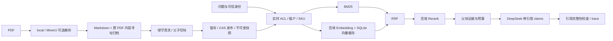

# 百炼接入、PDF 解析与部署实践报告

验收日期：2026-11-15。代码基线：`c7f046f` 加本轮工作区变更。本文记录本机真实调用与离线回归的边界；不是服务器部署完成声明，也不是模型正确率评测。

## 1. 本轮结论

- 三个用户指定的百炼模型均已真实请求成功，并通过现有角色接口接入完整问答链路。没有下载模型，Laya 仍未接入。
- 对根目录 14 页中文 Transformer 论文，本轮选择 MinerU 作为显式 `.env` 的 PDF 后端；本地 pypdf 后端保留，适合快速、离线的纯文本提取。无配置代码默认仍是 `local` 与 `model_free`。
- 当前部署需要单个应用容器、Caddy/等价 HTTPS 网关和持久卷。SQLite、文件归档和精确向量缓存均在应用侧运行，暂不额外部署数据库、Redis 或向量数据库。
- Docker Compose 配置已静态验证；本机 Docker Engine 未运行，因此没有完成镜像构建、容器启动和 Linux 云服务器验收。

## 2. 配置与可插拔边界

根目录 `.env` 已将用户原有模型名与凭证整理为变量，保留原 Key；没有将凭证写入本文、Git 或镜像。另生成了独立的项目 HTTP 令牌，不复用云平台 Key。

| 变量 | 用途 / 本次选择 |
| --- | --- |
| `RAG_ENABLE_CLOUD` | 显式本地配置已开启；仓库示例默认关闭 |
| `RAG_CLOUD_BASE_URL` | 百炼北京共享兼容根地址；协议见[接口核对](bailian-api-notes.md) |
| `RAG_CLOUD_API_KEY` | 三个云模型共用的出站凭证 |
| `RAG_LLM_MODEL` | `deepseek-v4.1-flash-1017` |
| `RAG_EMBEDDING_MODEL` | `qwen3.7-text-embedding-flash` |
| `RAG_RERANK_MODEL` | `qwen3.7-text-rerank` |
| `MINERU_API_KEY` / `MINERU_BASE_URL` | MinerU 独立凭证 / hosted v4 API |
| `RAG_PDF_BACKEND` | 显式本地配置选择 `mineru`；可用 `--backend local` / `--pdf-backend local` 覆盖 |
| `RAG_HTTP_API_TOKEN` | 本项目入站 HTTP Bearer token |
| `RAG_HTTP_TENANT` / `RAG_HTTP_SUBJECT` | 当前简化环境入口创建一个管理员身份；多身份按可信配置映射 |

CLI 必须显式传 `--env-file .env` 才读取此文件；容器使用 Compose 的 `env_file` 显式注入。进程环境覆盖文件值。仅放置 `.env` 不会自动开启普通 CLI 的模型调用。



云插件仅替换 `dense`、`reranker`、`generator`。规则规划、生命周期、ACL、BM25、RRF 与存储接口保持原有边界。向量缓存按服务根地址、模型和维度隔离；当前为授权文本集合内的精确余弦检索，尚非 ANN 索引。

## 3. 三个模型的真实最小调用

使用项目 `CloudTransport` 和真实角色适配器，未用模拟响应代替在线结果。测试内容为两条短句、两个排序候选以及一条证据；所有请求返回 HTTP 200，没有重试。

| 角色 | 观察结果 | 单次请求耗时 | 平台返回 token |
| --- | --- | ---: | ---: |
| Embedding | 两条输入、两个 1024 维有限向量 | 437.771 ms | 42 |
| Rerank | 相关候选排第一，得分约 0.9951；无关候选约 0.0011 | 276.801 ms | 53 |
| Generator | 返回 1 条 claim，使用给定证据 `e1`，生成可渲染答案 | 825.518 ms | 186 |

这些结果证明本机凭证、地域与接口合同在本次请求中可用，不代表总体回答准确率。Rerank 分数不作为事实正确率或跨请求概率。

## 4. PDF 对比方法与结果

样本：根目录 `transformer_zh_cn.pdf`，1,437,032 bytes，14 页。SHA256：`b7d9fec0b2938de80ed0bfbd15328e5506c0a49012666de96ee4f8625f2309cb`。用户原文件保持不变。

同一文件分别使用本地 pypdf layout 文本提取及 MinerU hosted `vlm`、中文、公式/表格识别。渲染原 PDF 的第 1、3、4、6、8 页，重点检查正文、注意力公式、多头公式、复杂度表和实验表；并抽查关键数字与顺序。没有构造全量人工金标，因此不报告虚构的准确率或召回率。

| 项目 | 本地 pypdf | MinerU hosted |
| --- | --- | --- |
| 页数 | 14 | 14 |
| 规范化输出字符 | 25,738 | 23,567（含末尾换行） |
| 本次解析耗时 | 1.2805 秒 | 约 29.681 秒，含上传/轮询/下载；见下方失败恢复说明 |
| 章节结构 | 14 个页标题，论文层级多为普通文本 | 25 个 Markdown 标题 |
| 公式 | 视觉位置与符号扁平化；分式关系容易损坏 | 5 个 LaTeX 公式块；核心缩放点积公式正确恢复 |
| 表格 | 文本依靠空格排版，列关系与跨行信息不稳定 | 5 个 HTML 表格，复杂表保留 rowspan 等结构 |
| 正文阅读顺序 | 按页，换行与空白较多 | 章节更连续，减少分页噪声 |
| 图像 | 无图像语义提取 | Markdown 含 4 个图像引用；本轮不归档/提供图片资源服务 |
| 外部依赖 | 无外发、无 Key | PDF 上传 MinerU，受网络/配额与服务状态影响 |

字符数不同不是质量优劣的依据。实际观察到：

1. 原 PDF 第 3 页缩放点积公式是 `softmax(QK^T / sqrt(d_k))V`。本地结果把分式压成连续符号；MinerU 保留了分子、分母与根号的 LaTeX 结构。第 4 页多头公式也保留为公式块。
2. 原 PDF 第 6 页的复杂度表，MinerU 将四种层类型与复杂度、顺序操作、最大路径长度分列；第 8 页实验表保留基础模型 `4.92 / 25.8` 与大型模型 `4.33 / 26.4` 等单元格。抽样数字 `28.4`、`41.8`、`92.7`、`100K`、`300K` 在输出中存在并与抽查页面一致。此为抽样核对，不是每格验收。
3. MinerU 并非无损：出现 `V_c`、多余符号等识别噪声；“训练和评估模型的代码可在……获取”处原本两个 NUL，清理后链接仍缺失。不能用它做逐字可靠的转录或自动认定所有公式正确。
4. 解析出的图片路径不是已发布资源；当前纯文本 RAG 不具备读图语义。MinerU 的页面坐标 JSON 尚未转换为证据定位，当前证据按解析 Markdown 的行/字符回源，不能把该定位称为原 PDF 页坐标。原 PDF 已独立归档。
5. HTML 表格和公式虽保留在 Markdown，现有字符切块仍可能拆开长表格或复杂公式。下一步应为它们增加结构感知切块和标注问答集。

**选择：本项目当前这类中文、公式/表格密集 PDF 优先 MinerU；本地 pypdf 保留为离线/简单文本方案。** 不自动静默降级，以免解析质量变化未被观察。数据不得外发时显式使用本地方案；本次没有评测扫描版 PDF 或更多领域文档。

### 解析异常与恢复

首次远端解析已到达 Markdown 校验，但因为两个 NUL 被适配器拒绝；当时未保存 batch，不能恢复。第二次带观测的提交保留 ZIP 与 batch，确认问题后修复为只移除 NUL、记录 `removed_nul_characters=2`。没有丢弃正文或用空文本假装成功。

修复后从第二批次恢复，仅 GET 状态与结果（2 次网络请求），1.338 秒成功返回 14 页、23,567 字符；这不是重新解析 1.338 秒的性能结论。随后直接 PDF 入库也复用原 batch，未再次 POST/上传。初期发生了两次远端提交；具体费用以 MinerU 账单为准。

新 `--checkpoint` / `--pdf-checkpoint` 绑定源文件哈希、文件名、服务根地址、模型和语言；记录提交不确定性并原子落盘。已知 batch 恢复只轮询和下载；提交响应丢失时停止自动重提。单调用者使用独立检查点；本轮未实现多 worker 的任务编排。

## 5. 完整 RAG 真实验收

将 MinerU 输出经已有清洗、父子切块、暂存、CAS 发布，再用真实三模型问答。31 个父块、113 个子块；测试问题：“Transformer 的缩放点积注意力如何计算？”

| 场景 | 状态 | 模型请求数 | 端到端耗时 | 证据 / claims |
| --- | --- | ---: | ---: | --- |
| 冷缓存问答 | `answered` | 9：7 Embedding（查询 1 + 文档批次 6）、1 Rerank、1 Generator | 8.717 秒 | 3 / 5 |
| 新建应用实例复用缓存 | `answered` | 3：查询 Embedding、Rerank、Generator | 4.224 秒 | 3 / 5 |
| 撤销该文档权限后 | `empty` | 0 | 未用作性能指标 | 0 / 0 |

冷请求平台返回总 token 28,076，热请求 10,037。答案包含正确的缩放点积公式与相关说明；出处完整性检查 `valid=true`，`support_checked=false`。这是一问的人工抽查，尚未接入语义蕴含验证。

另用 `ingest_pdf(..., backend="mineru", pdf_checkpoint=...)` 验证直接源 PDF 路径：原 PDF 内容寻址归档、31/113 切块、CAS 发布、真实问答 `answered`（3 证据、4 claims）。解析后归档前核对原 PDF SHA；源文件并发变化会拒绝入库。

本轮三模型最小测试与三次在线问答的返回 token 合计 66,344；这是请求响应中的计数汇总，不是金额或完整账单。原始 JSON、ZIP、Markdown、向量缓存与 trace 保留在 ignored 的 `.artifacts/`，不上传仓库。

## 6. 回归与独立运行态 QA

自动化覆盖：无模型默认与显式云开启、百炼协议、分批与维度校验、实际调用计量、429/5xx 有界重试、401/超时去密、缓存重启、ACL/租户隔离、未知引用拒绝、PDF 原档/变化检测、输出不可覆盖源文件/检查点、MinerU ZIP 边界与检查点恢复。最终 `python -m unittest discover -s tests -q` 运行 132 项，131 通过、1 项因 Windows 符号链接能力跳过，耗时 31.522 秒；`compileall`、`uv lock --check`、`git diff --check`、`docker compose config --quiet` 均通过。既存 Starlette TestClient 弃用提示仍保留。

交付前扫描了 54 个非忽略候选文件（排除用户 PDF 二进制）：没有发现真实云 Key、MinerU Key 或入站 token 的字节匹配。`.env` 和 `.artifacts/` 被 Git 忽略；Docker 构建上下文采用允许清单，不包含凭证、解析样本或运行数据库。原 HTML 与 PDF 的 SHA256 均未改变。扫描不是公开日志安全的替代，后续仍需保持凭证边界。

独立 QA 使用临时源码副本、合成配置和禁止外部网络的运行环境，实际执行 CLI 子进程与 loopback HTTP：

- 默认 `model_free`、发布前不可见、发布后跨进程可检索，trace 计量 0；不隐式读取 `.env`。
- 坏环境文件、启云缺字段安全失败；无 HTTP token 拒绝启动；健康检查 200，业务无/错 token 401、正确 token 200、伪造身份 422。
- PDF 解析、暂存、CAS 发布、新进程检索，原始归档 SHA 一致。
- MinerU fixture 验证首次 POST/PUT/GET/GET、恢复 GET/GET；另 20 项非法参数/查询边界安全失败。该部分是模拟协议，真实 MinerU 证据见上文。

曾发生一次检查点原子写 OSError；之后修改前后各连续复跑目标测试 20 次及完整套件均未复现，不能断言根因已修复。现在错误带安全的操作阶段与 errno/winerror，保留原检查点、清理临时文件、停止推进，不增加自动远端重试。

本轮没有完成正式三轴跨模型代码审阅或生产压测。独立 QA 报告留在操作系统临时目录；其源码副本/合成数据的清理被自动执行策略拒绝，未扩大权限重试，HTTP 进程已停止。

## 7. 本阶段中间件与 Docker

| 现在部署 | 方式 |
| --- | --- |
| RAG API | `Dockerfile` 构建，非 root 用户，单实例 |
| Caddy / 现有云 HTTPS 网关 | Compose 已配置 Caddy；当前只绑定宿主 `127.0.0.1:8080` |
| 持久化数据 | `/data` 卷，包含 SQLite、对象文件与派生向量缓存 |
| 模型 / MinerU | 出站 HTTPS API，不部署本地推理中间件 |

当前无需单独 MySQL/PostgreSQL、Milvus/Qdrant、Redis、MinIO 或 GPU 推理服务；达到多实例、大规模检索、共享对象或长任务需求后再实现对应插件并选择服务。具体扩容条件、持久卷、备份及公网 TLS 修改见[部署文档](../deployment.md)。

```powershell
docker compose config --quiet
docker compose build
docker compose up -d
```

后两条需要可用 Docker Engine；本机尚未执行成功。公网还需真实域名、HTTPS、端口/安全组与备份恢复验证。

## 8. 复现实践入口

```powershell
# 不加载 .env：继续使用无模型默认
uv run adaptive-rag capabilities

# 显式本地配置：三云模型已启用
uv run adaptive-rag --env-file .env capabilities

# 对照解析；每份 PDF 使用独立检查点
uv run adaptive-rag parse-pdf --file transformer_zh_cn.pdf --backend local --output .rag-data/local.md
uv run adaptive-rag --env-file .env parse-pdf --file transformer_zh_cn.pdf --backend mineru --checkpoint .rag-data/transformer-mineru.json --output .rag-data/mineru.md

# 直接 PDF 入库，原档与解析产物一并进入对象存储；随后显式 publish
$job = uv run adaptive-rag --env-file .env ingest --tenant demo --document transformer --version v1 --file transformer_zh_cn.pdf --pdf-backend mineru --pdf-checkpoint .rag-data/transformer-mineru.json | ConvertFrom-Json
# 初次发布可不带 expected-generation；已有快照须携带其当前 generation
uv run adaptive-rag --env-file .env publish --tenant demo --job $job.job_id
uv run adaptive-rag --env-file .env query --tenant demo --question 'Transformer 的缩放点积注意力如何计算？' --top-k 3
```

上述新检查点示例会创建新的 MinerU 作业；本轮已有任务恢复文件仅保留在本机 ignored 目录。不要为重复验收无意重提付费解析。

## 9. 下一阶段

先完成 Linux Docker 构建/启动、持久卷重建与恢复、HTTPS 鉴权；再建立跨文档、表格、公式和无答案问题的标注评测集。随后增加结构感知切块、PDF 页坐标回源、资源归档与可恢复后台入库。真实规模超过本地精确检索预算时，再替换为生产检索/向量存储插件。Laya 继续保持独立决策接口，待数据和策略指标稳定后再设计部署与微调。
