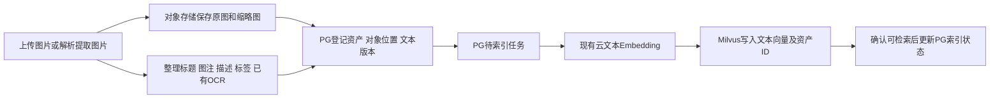
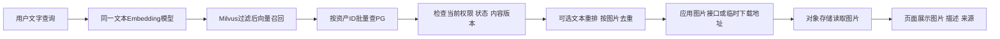

# 图片资产与描述文本检索：PostgreSQL、Milvus、对象存储可行性研究

研究日期：2026-11-16。资料范围：PostgreSQL、Milvus、S3、MinIO、pgvector 的官方文档与上游仓库。本稿区分“官方事实”“工程推论”和“建议”，记录研究阶段的设计依据。研究阶段没有读取凭据、安装依赖或调用付费模型。

后续已实现图片资料库、描述检索及 PostgreSQL / Milvus / S3 适配器，实际行为和未完成项见[图片资料库说明](../image-library.md)，候选部署方案见[存储部署说明](../../deploy/STORAGE.md)。实现与本地验收不代表已完成生产迁移；本报告中的建议也不应全部视为已实现功能。

**用户已确定范围：只做图片描述文本检索，不引入文字与图片共享向量空间的多模态模型。** 图片的标题、图注、人工语义描述、标签和已有 OCR 文本使用现有文本 Embedding 模型编码；查询使用同一文本模型。真正文生图仅说明未来如何复用存储，不属于当前实施范围。Laya 继续只保留接口。

## 1. 结论

**可行，建议以 PostgreSQL 为资产与业务状态的权威来源，对象存储保存图像文件，Milvus 保存可重建的检索索引。** 三者通过稳定的 `asset_id` 和明确的内容/索引版本关联。PostgreSQL 原生提供关系约束和本库事务；Milvus 提供向量、标量元数据与过滤检索；S3 类对象存储以 bucket/key 定位文件。[S1][S2][S3][S4]

这是职责划分建议，不是三个数据库共同提供的一笔事务。PG 外键不能约束外部对象或 Milvus 记录；Milvus 自身的一致性等级也不能使三套系统原子提交。跨系统写入需要状态机、可重试任务和对账修复。[S1][S2][S5][S6]

**当前目标是“用文字检索已有图片”：先检索图片的文字说明，再返回与说明关联的图片。** 描述可以人工填写，也可以复用文档图注和已有 OCR 结果，不要求新增看图模型。向量库执行检索，图片内容由对象存储交付；生成新图片属于另一个能力接口。

## 2. 对用户方案的细化

| 组件 | 建议保存 | 不建议作为其权威职责 |
|---|---|---|
| S3 兼容对象存储 | 原图、缩略图、生成图、必要的页图；按对象 key 获取字节 | 账号、权限、工单与资产状态 |
| PostgreSQL | `asset_id`、对象位置、来源、描述原文、标签、拥有者、内容版本、索引状态、生成任务与模型记录 | 大批原图二进制的默认存放地 |
| Milvus | embedding、`asset_id`、表示类型、内容版本、模型版本及必要过滤字段 | 图片文件；完整业务关系与唯一事实来源 |

这张表是工程建议。Milvus 的 schema 支持主键、向量和标量字段；PG 提供本库关系约束。把描述原文也保存在 PG，可以在替换向量库、切换文本 Embedding 模型或修复索引时直接重建，不必重新整理图片说明。[S1][S3]

### 2.1 对象位置应保存为稳定定位信息

建议持久化 `storage_backend`、`bucket`、`object_key`、可选的 `version_id`、校验和、MIME 类型、文件大小、宽高。S3 对象 key 在 bucket 内标识对象，“文件夹”通常只是 key 前缀，并非服务器上的真实目录。[S4]

临时签名 URL 按请求生成，不存作永久图片地址。官方 S3 文档说明其有有效期；底层临时凭据到期还可能使 URL 提前失效。MinIO 官方 Python SDK 也提供带到期时间、可指定对象版本的 `presigned_get_object`。[S8][S9]

向浏览器返回时，服务端先按当前账号与资产状态校验，再返回短时 URL，或通过应用的受控图片接口转发。Docker 内网地址不能直接当作浏览器可访问地址；签名时必须使用实际对客户端可达、与签名方案相符的地址。这是由对象寻址及签名机制得到的工程要求。[S4][S8]

### 2.2 ID 与版本关系

建议以 `asset_id` 标识资产，以 `revision_id` 标识内容版本，以 `representation_id` 标识具体检索表示。不要把三者简单地都命名为“图片 ID”。一张图可能有原图、缩略图、多段描述、OCR 文本和多种 embedding。

可使用以下概念表，具体字段以项目建模为准：

- `assets`：资产身份、归属、来源类型、当前内容版本、可见状态。
- `asset_objects`：原图/缩略图/页图等对象位置及完整性信息。
- `asset_descriptions`：描述、图注、已有 OCR、标签、文本版本与来源，例如人工填写、文档解析或外部导入。
- `asset_representations`：`asset_id`、`revision_id`、表示类型、embedding 模型、维度、归一化/距离度量、索引代次、同步状态。
- `index_jobs` 或 outbox：需要写入/删除索引的任务、幂等键、重试次数、错误与下次重试时间。
- `generation_jobs`：若以后做文生图，记录输入提示、模型与参数、任务状态、输出资产 ID 等。

这些是设计建议。Milvus 主键应由应用确定，关闭该集合的 AutoID，并使用稳定的 `representation_id` 做 upsert；这样失败重试能够覆盖同一条表示。官方文档说明普通 insert 不检查重复主键，直接重复 insert 可能产生重复实体；upsert 用给定主键插入或更新，AutoID 开启时存在不同语义，需避免混用。[S10][S11]

## 3. 当前确定的能力：描述驱动的文字搜图

### 3.1 入库流程

首版不依赖自动看图：上传时提供标题、描述、关键词；文档内图片可复用可靠提取的图注与已有 OCR 结果。缺少可用文字的纯图片保留为“待补描述”，可以查看文件，但不假装已经拥有语义索引。原图可用和语义检索就绪是两个状态。

例如一张图的描述为：“RAG 系统流程图，包含文档解析、切块、混合检索、重排、上下文组装、带引用生成”。用户查询“找一张展示检索增强生成完整流程的架构图”时，检索的是这段文字的语义，再通过资产 ID 返回图片。这只是说明工作方式的例子，不是本项目已经测得的命中结果。

一张图片不必只有一个向量。短描述可为一条表示，较长 OCR 可按合理边界切成多条文本表示，每条都有独立 `representation_id` 并指向同一图片版本。召回后按图片去重，避免同一张图占满结果；图号、SKU、文件名、标签等精确条件可走关键词或标量过滤，不全交给相似度。

### 3.2 检索与图片交付

Milvus 的过滤条件可以缩小召回范围，返回资产关联字段；跨库关联由应用批量完成，不是向量库直接 JOIN PG。账号、租户和版本状态仍以 PG 回查结果为准。[S1][S3]

首版可以复用现有文本 Reranker，对“用户问题—图片描述/OCR”排序。它并未查看图像像素，前端应展示真实命中的描述和来源，不把向量距离解释为图片正确率。

**能力边界：描述中没有表达的内容，检索通常无法凭图片本体补出来。** 如果要按颜色、布局或具体标注检索，就需要在描述或已有 OCR 中提供这些信息。改进重点应是描述完整度、图注关联准确度、文字切分和检索评测，而不是接入新的多模态向量模型。

### 3.3 文本向量版本

建议把 `model_id`、模型版本、维度、距离度量、归一化方式、文本处理版本作为索引契约。距离度量按现有文本模型要求选择，Milvus 支持 L2、IP、COSINE 等度量。切换模型或处理方式时，建立新的索引代次，回填并评测后切换读路径。[S13]

### 3.4 未来文生图的存储衔接

当前方案只检索已有图片。将来真正生成新图时，另设 `ImageGenerator` 接口，生成产物仍复用“对象存储保存字节 → PG记录资产与生成来源 → 补充文字说明 → 文本Embedding入索引”的链路。当前无需选定或接入生成模型，也不将生成任务作为此次落地前置条件。

## 4. 写入、删除与失败恢复

### 4.1 上传与索引

建议流程：

1. 创建资产/上传意图并分配稳定 ID，状态为待上传。
2. 上传对象并获取定位信息和校验结果。
3. 在同一笔 PG 事务内保存已上传对象元数据，并创建待索引任务；提交后才能由 worker 消费。
4. worker 读取该版本已确认的文字描述，调用现有文本 Embedding，缓存成功向量，再向 Milvus 幂等 upsert。
5. 更新 PG 中该内容版本、该索引代次的同步状态。检索就绪只在指定表示达到可用条件后成立。

PG 事务可保证本库元数据和任务同时提交；transactional outbox 是解决数据库修改与外部事件双写问题的常见方式，消费者仍需幂等处理重复投递。对象上传、云模型调用与 Milvus 更新都不属于该 PG 事务，因此还需补偿与对账。[S2][S6]

建议以“已保存、待索引、索引中、可检索、索引失败”表达实际状态，避免对象上传完成就报告全部完成。外部文本模型调用放在 PG 事务之外；可先返回任务 ID，让前端继续展示各阶段与错误。初版可以由 PG 任务表加 worker 完成，不必因此立即增加消息队列。

### 4.2 典型失败与处理

| 失败 | 建议处理 |
|---|---|
| 对象上传完成，PG 提交失败 | 根据上传意图恢复关联；超期且未关联的对象由延迟清理任务处理 |
| 描述已保存，embedding 失败 | 保留描述与文本版本，仅重试未成功步骤 |
| Milvus 写入成功，PG 状态更新失败 | 幂等重试，依据表示 ID 与版本对账修复 |
| 描述或图片被更新，旧索引任务迟到 | 使用内容版本/索引代次隔离；读路径只认可 PG 当前版本；避免旧任务覆盖同一活动表示 |
| 检索命中已删除或失权资产 | PG 权威校验过滤，不生成图片下载地址 |
| 候选经过权限/版本校验后不足 top K | 扩大候选或继续分页获取，设定上限并返回实际可用数量 |

### 4.3 删除

建议先在 PG 标记不可见并写入删除任务，再清理 Milvus 表示和对象文件；清理失败可重试，并由对账任务发现残留。这样旧索引即使短暂可见也不能通过 PG 校验得到图片。共享对象、对象版本或删除保留期需要单独规则，不能按每条命中简单删文件。

Milvus 官方列出 strong、bounded、session、eventual 四种一致性，默认 bounded staleness；可在立即写入后检索的验收中使用 strong，但这不替代跨系统状态与版本校验。[S5]

## 5. 部署代价与替代路径

### 5.1 Milvus 的代价需要纳入当前服务器容量

官方 Standalone 前置条件表列出 RAM 最低 8G、推荐 16G，推荐 CPU 至少 4 核，使用 SSD，推荐 NVMe；这些不是同时运行项目 API、PG、对象存储及其他既有服务后的整机余量保证。[S14]

当前官方部署文档存在不同形态：Docker 脚本形态使用嵌入式 etcd 与本地文件系统对象存储，不包含独立 MinIO 容器；Compose 形态列出独立 etcd 和 MinIO，并固定相应镜像。因此不应笼统称“Milvus 必须再部署一套 etcd/MinIO”；应按实际采用版本和官方 compose 审查依赖。[S14]

上述未版本化文档在本次检索中含 Milvus 3.0.x/3.0.5 上下文；它不证明项目现有配置属于该版本。正式实施前需锁定服务端、SDK 与部署模板相容版本，确认 CPU 指令集、内存余量、持久卷、备份恢复与负载测试。研究阶段没有核查服务器资源。

应用图片存储桶与 Milvus 内部存储至少采用独立 bucket/权限/生命周期规则；Milvus 内部对象不能作为应用图片资产管理。这是隔离维护和误删影响的工程建议。

### 5.2 MinIO 当前上游状态

**2026-11-16 访问官方 `minio/minio` 仓库时，该仓库显示已归档，页面标注归档时间为 2026-04-25，仓库 API 的 `archived` 也为 true，许可证为 AGPL-3.0。** 这不表示已经运行的实例立即不可用，但意味着新生产部署不能默认沿用“社区仓库持续维护”的前提。[S15]

因此建议把端口命名为 `ObjectStore`，具体选用 S3 兼容实现；新增生产部署前核实 MinIO/AIStor 的具体产品、镜像来源、发布渠道、维护与许可条件，也可评估云对象存储。当前已有对象存储适配器如果满足端口契约，可以继续保留。本次未能完整访问跳转后的 AIStor 开发文档，因此不据此声明某个发行版免费、收费或有特定支持承诺。没有将非官方“镜像下架”等信息作为结论。

### 5.3 初期可以比较 PostgreSQL + pgvector

官方 pgvector 上游支持在 PostgreSQL 内做精确和近似向量检索，与其他数据保存在一起。这使“PG + 对象存储 + 可替换 VectorStore”成为基础设施更少的候选方案。采用 pgvector 并不妨碍以后迁到 Milvus，条件是业务层使用统一的向量检索端口和模型契约。[S16]

pgvector 并非无条件优于 Milvus：其官方文档说明 ANN 索引后的过滤会导致结果不足，iterative scans 可继续扫描但仍有扫描上限，需要结合租户过滤选择性和延迟评测。[S16]

没有可靠的统一“图片数量超过某数就必须 Milvus”阈值。本项目应按真实 embedding 维度、向量数量、更新/删除频率、过滤条件、并发、Recall@K、p95 延迟、内存和运维预算选择。若近期确定要学习并验证 Milvus，可保留它作为目标适配器，但不要跳过服务器容量和一致性设计。

## 6. 建议的验收与仍需确认的问题

验收建议用一组固定图片与人工标注查询，覆盖同义词、中文描述、图中文字、无匹配、相近图与重复图；比较描述向量、已有 OCR/关键词混合检索。布局/颜色类查询应同时核验这些信息是否已经写入描述。记录 Recall@K、首个有效命中、端到端 p50/p95，以及文字整理、Embedding、向量查询、PG 回查、下载地址生成各阶段耗时。评分阈值与 top K 应在样本上校准，不能把相似度数值直接显示为事实置信概率。

工程验收还应覆盖：同一任务重试不产生重复表示；删除后不给出下载地址；旧版本任务不覆盖新内容；对象存储/PG/Milvus 任一短暂失效后可恢复；重建索引不重新生成已有且可用的描述；账号过滤在候选过滤与最终回查均生效。以上均为建议验收项，不是已经通过的测试。

影响落地选择的未知项：

- 首个资产集合来自文档提取还是用户上传，先选一小批有可靠说明的图片作验收样本。
- 描述字段与已有 OCR 的完整度、描述维护方式；当前不增加视觉理解或跨模态 Embedding 模型。
- 当前服务器可用内存/CPU/磁盘，图片与向量规模、并发及增长预期。

这些未知项影响容量与验收，不阻碍先设计可替换的端口和资产关联。

## 7. 与当前项目源码的适配

本节为当前仓库代码审计结果，不是根据上游资料推测。现有插件化基础能够延续，但图片资产、远程检索和数据迁移仍需要实际开发。

| 现有实现 | 已有能力与具体差距 | 建议改动 |
|---|---|---|
| [ports.py](../../adaptive_rag/ports.py) 第24行 `ObjectStore`；[storage.py](../../adaptive_rag/storage.py) 第45行 `FileObjectStore` | 已有按内容哈希存取字节，端口仅有 `put/get` | 增加 S3 对象适配器，另补图片元数据、缩略图和交付能力；保留本地文件适配器用于开发 |
| [ports.py](../../adaptive_rag/ports.py) 第29行 `KnowledgeStore`；[storage.py](../../adaptive_rag/storage.py) 第212行 `SQLiteKnowledgeStore` | 已有暂存、发布、父子块、快照、CAS、撤权 | 增加 PG 适配器并保持原有语义，不将迁库误认为只改连接字符串 |
| [plugins.py](../../adaptive_rag/plugins.py) 第86行 | store、objects、trace 已独立注入 | 分别注册 PG、S3 适配器；账号迁移另行处理 |
| [cloud.py](../../adaptive_rag/cloud.py) 第331行 `CloudDenseRetriever` | `cloud-vectors.sqlite3` 缓存，查询时补算缺失文本向量，再逐块计算余弦；不是 ANN 数据库 | 文本向量提前在导入/后台任务中生成；Milvus 只执行过滤与候选召回 |
| [pipeline.py](../../adaptive_rag/pipeline.py) 第264行；[ports.py](../../adaptive_rag/ports.py) 第49行 `Retriever` | 先读全部授权 `ChildChunk`，再把全量块传给检索器 | 引入含租户、快照和过滤条件的检索上下文，召回候选 ID 后批量回填；避免远程检索仍依赖全量枚举 |
| [ports.py](../../adaptive_rag/ports.py) 第78行 `Embedder`；[cloud.py](../../adaptive_rag/cloud.py) 第297行 | 已支持文本序列的云 Embedding | 直接复用编码图片描述；不增加图像输入或跨模态编码端口 |
| [domain.py](../../adaptive_rag/domain.py) 第171、261、274行 | `ChildChunk`、`Hit`、`Evidence` 面向文本，不能完整表达图片对象及位置 | 增加 `Asset`、资产版本、文字表示和 `ImageSearchHit`；保留图片来源与文本证据的关联 |
| [auth.py](../../adaptive_rag/auth.py) 第72行；[api.py](../../adaptive_rag/api.py) 第84行 | 账号、session 单独存在 `accounts.sqlite3`，不经 KnowledgeStore 自动切换 | 若本次迁移账号到 PG，要保留用户 subject ID 和归属；否则明确阶段内继续使用原账号库 |
| [deploy/compose.server.yaml](../../deploy/compose.server.yaml) 第6行 | 当前只有 API，1 CPU/768MiB 是 API 容器限额 | 为本项目单独核对和分配数据库、对象存储及 worker 的资源；不据此推定整台服务器容量 |

另外有四项契约需要延续：

1. **内容寻址**：[domain.py](../../adaptive_rag/domain.py) 第130行要求 `source_object_key` 是64位 SHA256。S3 适配器可以把这个 key 映射到 bucket/object_key，或显式引入对象定位类型；不能把完整下载 URL 填入该字段。
2. **发布与快照**：[storage.py](../../adaptive_rag/storage.py) 第363行起，发布使用 `expected_generation`，快照保存 document→revision 清单。向量就绪状态须与不可变内容版本关联；不能给每条向量仅贴一个当前 generation 就宣称支持全部历史快照，也不应每次发布复制全部向量。
3. **撤权与删除**：[pipeline.py](../../adaptive_rag/pipeline.py) 第317、344行当前回填和返回证据前会复核权限。新增图片命中也应延续这一语义，Milvus 的旧记录不能绕过 PG 当前状态。
4. **独立配置**：[environment.py](../../adaptive_rag/environment.py) 第56行起的云开关会一起选择 cloud dense/reranker/generator。远程 PG、对象存储、Milvus 的选择应使用独立配置，不让“启用远程数据库”隐式开启模型调用。

**PDF 图片需要单独补齐提取与回源。** 当前 PDF 入口归档原文件并解析为 Markdown，但没有完整的图片资产持久化与图片服务。接入对象存储不会自动把论文里的图变成可检索资产；要同时提取图像字节、建立图注关联、记录来源文档与版本，以及实际能取得的页码/位置。无法可靠取得的位置不应虚构。

## 8. 建议的实施顺序与完成标准

### 8.1 先建立 PG 与对象存储资产链路

新增 PG 与 S3 适配器，建立资产、对象位置、文字描述和索引任务表，保留 SQLite/File 的本地适配器。图片首先支持上传、预览、下载、修改描述、删除；同一资产具有稳定 ID，文件和文字各自记录版本。PG 业务迁移、账号迁移、trace 迁移分项验收，避免将部分迁移表述为全部完成。

完成标准：重启后资产可读；原图、缩略图与说明匹配；现有文档快照、账号和权限语义保持；图片返回地址在实际浏览器可达；删除后应用不再返回图片内容。PG 与对象存储的备份和恢复需要分别验证，现有 SQLite 冷备完整性检查不能直接当作 PG 恢复验收。

### 8.2 接入 Milvus 后台索引，完成描述检索闭环

后台任务使用现有文本 Embedding，按图片版本和文本表示 ID 幂等写入 Milvus；查询改为候选召回、PG 批量核验、可选文本重排、按图片去重、返回图片。描述更新后只重建受影响的文字表示。若模型调用结果不明，沿用现有对付费请求的重试规则，不把数据库幂等当作云调用一定不会重复计费。

完成标准：固定图片集上的语义查询能返回人工标注的图片；OCR 中的图号/关键词可以精确辅助查找；索引未就绪、空结果和后端失败分别展示；重复任务、迟到任务和短暂故障不会产生错误版本或重复结果。模型版本切换可以重建、校验与回退。

### 8.3 补齐前端可观察性

沿用现有逐步 trace 页面，图片查询增加 `query_embedding`、`milvus_search`、`pg_hydrate`、`access_check`、`text_rerank`、`asset_delivery` 等阶段，展示真实耗时、候选数、过滤后数量、命中文本和关联资产 ID。入库展示对象写入、元数据保存、Embedding 和索引就绪状态。

返回结果建议包含图片预览、标题/描述、命中的文字片段、来源文档/可用页码、图片版本、检索分数与 trace ID。图片经应用接口或短时 URL 加载；服务器生成地址的耗时与浏览器加载图片的耗时分开记录，避免把“返回了 URL”算成“图片已经显示”。

### 8.4 当前不扩展的能力

不引入共享文字/图像向量空间的模型，不部署 Laya。当前图片检索可以复用现有文本 Embedding，按需复用文本 Reranker；不需要新增模型角色。未来文生图只预留独立接口和生成来源字段，不影响上述流程先完成。

本报告保留可行性分析和实施建议；后续实现情况以图片资料库及部署说明为准。尚未进行生产数据库迁移、生产部署或性能压测，部署可行性仍需结合实际服务器余量和选定发行版确认。

## 官方来源

以下均于 2026-11-16 访问；未版本化文档可能后续变化，实施时需锁定实际版本。

- [S1] PostgreSQL，Constraints：<https://www.postgresql.org/docs/current/ddl-constraints.html>。
- [S2] PostgreSQL，Transactions：<https://www.postgresql.org/docs/current/tutorial-transactions.html>。
- [S3] Milvus，Schema：<https://milvus.io/docs/schema.md>；Filtered Search：<https://milvus.io/docs/filtered-search.md>。
- [S4] AWS S3，Naming Amazon S3 objects：<https://docs.aws.amazon.com/AmazonS3/latest/userguide/object-keys.html>。
- [S5] Milvus，Consistency：<https://milvus.io/docs/consistency.md>。
- [S6] AWS Prescriptive Guidance，Transactional outbox pattern：<https://docs.aws.amazon.com/prescriptive-guidance/latest/cloud-design-patterns/transactional-outbox.html>。
- [S8] AWS S3，Download and upload objects with presigned URLs：<https://docs.aws.amazon.com/AmazonS3/latest/userguide/using-presigned-url.html>。
- [S9] MinIO 官方 Python SDK API，`presigned_get_object`：<https://github.com/minio/minio-py/blob/master/docs/API.md>。该文档本次可访问，未据此假设对象存储服务端仍持续维护。
- [S10] Milvus，Insert Entities：<https://milvus.io/docs/insert-update-delete.md>。
- [S11] Milvus，Upsert Entities：<https://milvus.io/docs/upsert-entities.md>。
- [S13] Milvus，Similarity Metrics：<https://milvus.io/docs/metric.md>。
- [S14] Milvus，Requirements for installing Milvus with Docker：<https://milvus.io/docs/prerequisite-docker.md>。
- [S15] MinIO 官方服务端仓库：<https://github.com/minio/minio>；官方仓库 API：<https://api.github.com/repos/minio/minio>。
- [S16] pgvector 官方上游 README：<https://github.com/pgvector/pgvector/blob/master/README.md>。此次读取的 README 安装示例引用 v0.8.7；本报告没有建议安装命令或锁定该版本。
